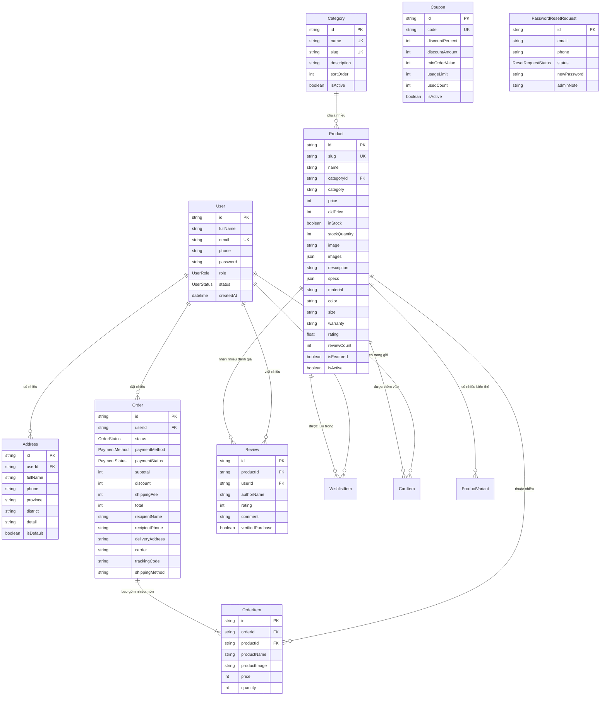

# 🪑 TỔNG HỢP TOÀN BỘ CHỨC NĂNG HỆ THỐNG E-COMMERCE ERGOCHAIR
## NỀN TẢNG THƯƠNG MẠI ĐIỆN TỬ GHẾ CÔNG THÁI HỌC CAO CẤP

> **Phiên bản hệ thống:** v2.0.0 (Production-Ready)  
> **Kiến trúc:** Next.js 16 App Router (Fullstack) + Clean Architecture (Repository Pattern & Service Layer)  
> **Cơ sở dữ liệu:** MySQL / MariaDB (Quản trị bằng Prisma ORM v6.19.3)  
> **Công nghệ giao diện:** React 19, TypeScript 5, Vanilla CSS Design Tokens, Phong cách tối giản cao cấp Zevora (Warm Minimalist & Editorial Design)  
> **Trí tuệ nhân tạo:** AI ErgoBot RAG Assistant (Tích hợp Groq AI LLM + Heuristic Deterministic Fallback Engine)

---

## 📑 MỤC LỤC TỔNG HỢP

1. [Tổng Quan Kiến Trúc & Ngăn Xếp Công Nghệ (Tech Stack)](#1-tổng-quan-kiến-trúc--ngăn-xếp-công-nghệ-tech-stack)
2. [Sơ Đồ Luồng Nghiệp Vụ & Phân Hệ Hệ Thống](#2-sơ-đồ-luồng-nghiệp-vụ--phân-hệ-hệ-thống)
3. [Phân Hệ Khách Hàng (Storefront / Client-Facing)](#3-phân-hệ-khách-hàng-storefront--client-facing)
   - 3.1. Trang Chủ (Landing Page - `/`)
   - 3.2. Trang Danh Mục & Bộ Lọc Đa Tiêu Chí (Catalog - `/products`)
   - 3.3. Trang Chi Tiết Sản Phẩm & Đánh Giá (Product Detail - `/products/[id]`)
   - 3.4. Giỏ Hàng Mua Sắm (Shopping Cart - `/cart`)
   - 3.5. Quy Trình Đặt Hàng & Thanh Toán (Checkout - `/checkout`)
   - 3.6. Cổng Thanh Toán Trực Tuyến Giả Lập (Payment Gateway Sandbox - `/checkout/payment`)
   - 3.7. Xác Nhận Đơn Hàng Thành Công (Order Success - `/order-success`)
   - 3.8. Tra Cứu Hành Trình Đơn Hàng (Order Tracking - `/orders`)
   - 3.9. Danh Sách Sản Phẩm Yêu Thích (Wishlist - `/wishlist`)
   - 3.10. Quản Lý Tài Khoản Cá Nhân & Sổ Địa Chỉ (Account Management - `/account`)
   - 3.11. Xác Thực Người Dùng & Quên Mật Khẩu (`/login`, `/register`)
   - 3.12. Giới Thiệu & Thông Tin Liên Hệ (`/about`, `/contact`)
   - 3.13. Trang Báo Lỗi Điều Hướng 404 (`/not-found`)
   - 3.14. Trợ Lý Ảo Chatbot AI Công Thái Học (AI ErgoBot Widget)
   - 3.15. Widget Kênh Hỗ Trợ & Liên Hệ Nhanh (Floating Contact Widget)
   - 3.16. Trải Nghiệm Điều Hướng & Hiệu Ứng Chuyển Động (UX/UI Highlights)
4. [Phân Hệ Quản Trị Viên (Admin Portal - `/admin`)](#4-phân-hệ-quản-trị-viên-admin-portal--admin)
   - 4.1. Bảng Điều Khiển Tổng Quan (Admin Dashboard)
   - 4.2. Quản Lý Sản Phẩm Toàn Diện (Product Management)
   - 4.3. Quản Lý Danh Mục Hàng Hóa (Category Management)
   - 4.4. Quản Lý Đơn Hàng & Vận Đơn (Order & Shipping Management)
   - 4.5. Quản Lý Khách Hàng, Nhân Sự & Cấp Lại Mật Khẩu (Customer & User Management)
5. [Hệ Thống Trợ Lý Ảo AI & Phân Loại Ý Định (AI Intents & RAG Architecture)](#5-hệ-thống-trợ-lý-ảo-ai--phân-loại-ý-định-ai-intents--rag-architecture)
6. [Hệ Thống Dữ Liệu Vị Trí Địa Lý & Tính Cước Vận Chuyển](#6-hệ-thống-dữ-liệu-vị-trí-địa-lý--tính-cước-vận-chuyển)
7. [Hệ Thống Custom Hooks & State Providers](#7-hệ-thống-custom-hooks--state-providers)
8. [Cơ Sở Dữ Liệu & Mô Hình Thực Thể (Database Schema)](#8-cơ-sở-dữ-liệu--mô-hình-thực-thể-database-schema)
9. [Dữ Liệu Hạt Giống Ban Đầu (Seeded Database Data)](#9-dữ-liệu-hạt-giống-ban-đầu-seeded-database-data)
10. [Danh Mục Toàn Bộ API Endpoints (Backend Route Handlers)](#10-danh-mục-toàn-bộ-api-endpoints-backend-route-handlers)
11. [Các Cơ Chế An Toàn, Tối Ưu & Bảo Vệ Dữ Liệu](#11-các-cơ-chế-an-toàn-tối-ưu--bảo-vệ-dữ-liệu)

---

## 1. TỔNG QUAN KIẾN TRÚC & NGĂN XẾP CÔNG NGHỆ (TECH STACK)

Hệ thống **ErgoChair** được thiết kế theo mô hình **Fullstack Next.js**, kết hợp khả năng Server-Side Rendering (SSR), Client-Side Hydration và RESTful Route Handlers chuẩn Clean Architecture:

```
┌────────────────────────────────────────────────────────────────────────┐
│                   GIAO DIỆN NGƯỜI DÙNG (FRONTEND)                     │
│  • Khách hàng (Storefront)         • Quản trị viên (Admin Portal)     │
│  • React 19 + Context API          • Vanilla CSS (Design Tokens)      │
│  • Responsive Design (Mobile/PC)   • Custom Easing Animation Engine   │
└───────────────────────────────────┬────────────────────────────────────┘
                                    │ HTTP / RESTful API (JSON)
┌───────────────────────────────────▼────────────────────────────────────┐
│                  TẦNG XỬ LÝ BACKEND (NEXT.JS ROUTE HANDLERS)           │
│  • Auth: Node.js Crypto PBKDF2    • Validation: Zod Schemas            │
│  • Media Uploads: /api/upload     • AI: Groq REST API (Fetch) + RAG    │
│  • Clean Architecture: Repositories (Product, Order, User, Coupon,...) │
└───────────────────────────────────┬────────────────────────────────────┘
                                    │ Prisma ORM Client
┌───────────────────────────────────▼────────────────────────────────────┐
│                    CƠ SỞ DỮ LIỆU (MYSQL / MARIADB)                    │
│  • 10 Bảng quan hệ (User, Product, Order, Category, Review, Coupon...) │
│  • Indexes tối ưu tìm kiếm, Foreign Keys, Cascade Constraints          │
└────────────────────────────────────────────────────────────────────────┘
```

- **Runtime & Ngôn ngữ:** Node.js 20+, TypeScript 5 (Định kiểu chặt chẽ 100%).
- **Web Framework:** Next.js 16.3.2 (App Router).
- **Thư viện UI & State:** React 19.2.8 (`useContext`, `useMemo`, `useCallback`, `useState`, `useRef`).
- **ORM & Database:** Prisma Client 6.19.3 kết nối trực tiếp MySQL Database (`ergochair_db`).
- **Cơ chế Xác thực & Mã hóa Mật khẩu:**
  - Sử dụng module gốc của Node.js (`node:crypto`) với thuật toán **PBKDF2 SHA-512** (1000 vòng lặp, muối ngẫu nhiên 16 byte qua `crypto.randomBytes(16)`, khóa băm 64 byte, định dạng lưu trữ `${salt}:${hash}`).
  - Tích hợp cơ chế backward-compatible / plain text fallback (`if (password === storedHash) return true;`) giúp tương thích với các tài khoản ban đầu được khởi tạo từ file seed.
- **Quản lý Phiên Người Dùng (Session Management):**
  - Quản lý phiên phía Client bằng `localStorage` (`ergochair-auth-session`).
  - Đồng bộ tức thì giữa tất cả các tab trình duyệt thông qua Custom DOM Event `ergochair-auth-change` và sự kiện `storage`.
  - Cơ chế tự động đồng bộ thời gian thực: Khi người dùng truy cập trang, hệ thống gọi `GET /api/auth/me?id=${sessionUser.id}` để tải dữ liệu mới nhất từ MySQL, đồng thời kiểm tra nếu tài khoản bị khóa (`blocked`) sẽ lập tức xóa phiên và ngắt quyền truy cập.
- **Tích hợp Trí tuệ Nhân tạo (AI ErgoBot):**
  - Kết nối trực tiếp mô hình ngôn ngữ lớn qua **Groq REST API** (`https://api.groq.com/openai/v1/chat/completions`) sử dụng Native `fetch` với chế độ JSON Object (không cần cài thêm SDK bên ngoài).
  - Mô hình AI chính: `openai/gpt-oss-120b`; Danh sách mô hình dự phòng: `qwen/qwen3.8-27b`, `llama-3.3-70b-versatile`, `openai/gpt-oss-20b`.
  - Kiểm soát độ trễ: Tích hợp `AbortController` với thời gian chờ tối đa 3500ms; nếu quá thời gian hoặc API gặp sự cố, hệ thống tự động chuyển tiếp sang **Bộ máy Heuristic Regex nội bộ (Deterministic Fallback)** để trả lời ngay lập tức mà không làm gián đoạn người dùng.
- **Hệ thống Typography Zevora đa tầng:**
  - Font nền giao diện (Pangea Fallback ~88%): `Work_Sans` (Menu, tên sản phẩm, nút bấm, body text).
  - Font tiêu đề lớn (Criteria CF Fallback ~12%): `Plus_Jakarta_Sans` (Tiêu đề h1, h2, h3).
  - Font mềm mại bổ trợ: `Lora` và `Playfair_Display` (Editorial Serif trang trọng).
  - Font bo tròn mềm mại: `Baloo_2` (Fallback phong cách DVN Coffee Spark).
- **Styling Architecture:** Vanilla CSS mô-đun hóa với các biến CSS Design Tokens (Màu be `--paper: #f5f4ef`, trắng kem `--cream: #e9eee7`, nâu da sồi, xám than chì `--ink: #1c1917`, xanh olive `--olive: #687d68`).

---

## 2. SƠ ĐỒ LUỒNG NGHIỆP VỤ & PHÂN HỆ HỆ THỐNG

```mermaid
flowchart TD
    Guest([Khách hàng duyệt Web]) --> Home[Trang Chủ /]
    Guest --> Catalog[Danh Mục Sản Phẩm /products]
    Catalog --> Filter[Lọc giá / Danh mục / Tồn kho / Sắp xếp]
    Filter --> Detail[Chi Tiết Sản Phẩm /products/:id]
    
    Detail -->|Thêm giỏ / Mua ngay| Cart[Giỏ Hàng /cart]
    Detail -->|Thả tim| Wishlist[Yêu Thích /wishlist]
    Detail -->|Đánh giá sao| Review[Gửi Đánh Giá Sản Phẩm]
    
    Cart --> Checkout[Đặt Hàng & Điền Địa Chỉ /checkout]
    Checkout -->|Chọn COD| Success[Hoàn Tất Đơn Hàng /order-success]
    Checkout -->|Chọn Online / VNPAY / MoMo / Bank| PayGateway[Cổng Thanh Toán /checkout/payment]
    PayGateway -->|Xác nhận Sandbox| Success
    
    Success --> Tracking[Tra Cứu Vận Đơn /orders hoặc /account]
    
    Guest --> Chatbot[AI ErgoBot Widget]
    Chatbot -->|Tư vấn ghế & Tra đơn hàng trực tiếp| Catalog
    
    AdminUser([Quản Trị Viên]) --> AdminLogin[/login]
    AdminLogin --> AdminDash[Admin Dashboard /admin]
    AdminDash --> AdminProd[Quản Lý Sản Phẩm]
    AdminDash --> AdminCat[Quản Lý Danh Mục]
    AdminDash --> AdminOrd[Quản Lý Đơn Hàng]
    AdminDash --> AdminCust[Quản Lý Khách Hàng & Reset Mật Khẩu]
```

---

## 3. PHÂN HỆ KHÁCH HÀNG (STOREFRONT / CLIENT-FACING)

### 3.1. Trang Chủ (Landing Page - `/`)
- **Sticky Site Header:**
  - Thanh điều hướng cố định trên cùng màn hình với hiệu ứng Glassmorphism mờ đục sang trọng (`backdrop-filter: blur(14px)`).
  - Logo thương hiệu phong cách Editorial typography với biểu tượng cách điệu xoay `-12deg`.
  - Dropdown động hiển thị toàn bộ danh mục sản phẩm lấy trực tiếp từ MySQL.
  - Biểu tượng giỏ hàng tích hợp Badge hiển thị số lượng sản phẩm tức thì.
  - Biểu tượng yêu thích (Wishlist) kèm số lượng sản phẩm đã lưu.
  - Nút điều hướng Tài khoản / Đăng nhập / Chuyển hướng nhanh sang trang Quản trị đối với Admin.
  - Drawer menu thu gọn hỗ trợ tối ưu trên điện thoại di động và máy tính bảng.
- **Hero Section:**
  - Tiêu đề nghệ thuật và slogan truyền cảm hứng về chăm sóc cột sống.
  - Nút kêu gọi hành động (CTA) "Khám phá bộ sưu tập" dẫn trực tiếp đến danh mục.
  - Các chỉ số uy tín (10.000+ khách hàng tin tưởng, 5 năm bảo hành, 100% chính hãng).
- **Khối Thương Hiệu Tin Dùng (Trust Badges):**
  - Hiển thị logo các doanh nghiệp và đối tác tiêu biểu sử dụng sản phẩm.
- **Bộ Sưu Tập Sản Phẩm Nổi Bật (Featured Products):**
  - Thanh Tab lọc nhanh sản phẩm theo danh mục ngay trên trang chủ (`Tất cả`, `Ghế công thái học`, `Ghế văn phòng`, `Ghế lãnh đạo`, `Ghế gaming`).
  - Thẻ sản phẩm chuẩn thẩm mỹ: Nhãn "Bán chạy #1", nhãn giảm giá `-X%`, nhãn "Mới", nhãn cảnh báo "Tạm hết".
  - Thao tác nhanh: Nút "Thêm vào giỏ" không rời trang, nút "Mua ngay" chuyển thẳng đến giỏ, nút "Thả tim" lưu yêu thích.
- **Danh Mục Trực Quan Theo Nhu Cầu:**
  - 4 khối thẻ danh mục lớn minh họa rõ đặc trưng và công năng từng dòng ghế.
- **Giá Trị Cốt Lõi Thương Hiệu (Brand Values):**
  - 4 trụ cột cam kết: Thiết kế công thái học chuẩn chỉnh, Bảo hành chính hãng 5 năm tận nơi, Miễn phí giao hàng toàn quốc, Đổi mới trong 30 ngày nếu lỗi sản xuất.
- **Đánh Giá & Phản Hồi Từ Khách Hàng (Customer Testimonials):**
  - Băng chuyền hiển thị đánh giá thực tế từ các chuyên gia lập trình viên, designer, doanh nhân với số điểm trung bình 4.9/5 sao.
- **Khối Sản Phẩm Đã Xem Gần Đây (Recently Viewed Products):**
  - Tự động hiển thị các mẫu ghế người dùng vừa xem để thuận tiện so sánh và quay lại đặt mua.

---

### 3.2. Trang Danh Mục & Bộ Lọc Đa Tiêu Chí (Catalog - `/products`)
- **Bộ Lọc Đa Tầng Thời Gian Thực (Multi-attribute Realtime Filtering):**
  - **Lọc theo Danh mục:** Lấy danh sách danh mục trực tiếp từ database (Tất cả loại ghế, Ghế công thái học, Ghế văn phòng, Ghế gaming, Ghế lãnh đạo).
  - **Lọc theo Khoảng giá:**
    - Dưới 5 triệu VNĐ (`under-5m`)
    - Từ 5 đến 8 triệu VNĐ (`5m-8m`)
    - Từ 8 đến 12 triệu VNĐ (`8m-12m`)
    - Trên 12 triệu VNĐ (`above-12m`)
  - **Lọc theo Tình trạng tồn kho:**
    - Tất cả sản phẩm
    - Còn hàng trong kho (`in-stock`)
    - Tạm hết hàng (`out-of-stock`)
  - **Sắp xếp linh hoạt (Sort Options):**
    - Sản phẩm nổi bật nhất
    - Giá từ thấp đến cao (Tăng dần)
    - Giá từ cao đến thấp (Giảm dần)
    - Đánh giá cao nhất (Xếp hạng sao)
- **Đồng Bộ Trạng Thái Lọc Lên URL Không Reload:**
  - Sử dụng cơ chế `window.history.replaceState` để lưu bộ lọc lên URL query params mà **không làm reload trang và không giật nhảy vị trí cuộn**.
- **Tìm Kiếm Tức Thì Bằng Thuật Toán Tiếng Việt (Instant Vietnamese Search):**
  - Tích hợp hàm `normalizeSearchText` loại bỏ dấu thanh, chuẩn hóa ký tự `đ/Đ` -> `d`, hỗ trợ gõ có dấu lẫn không dấu.
- **Cơ Chế Lướt Trang Chậm Rãi Cao Cấp (Custom Easing Smooth Scroll Engine):**
  - Khi người dùng bấm danh mục từ menu Header hoặc trang chủ, trang chuyển sang `/products` và kích hoạt hiệu ứng cuộn chậm có gia tốc `easeInOutCubic` trong thời lượng `900ms`.
  - Tự động tính toán bù trừ chiều cao Fixed Header (Desktop `94px`, Mobile `76px`) giúp danh sách sản phẩm hiển thị chuẩn xác, không bị che khuất.
- **Xử Lý Thẻ Sản Phẩm Tạm Hết Hàng:**
  - Hiển thị nhãn phủ mờ "Tạm hết hàng", vẫn cho phép người dùng click xem chi tiết thông số và đăng ký tư vấn.

---

### 3.3. Trang Chi Tiết Sản Phẩm & Đánh Giá (Product Detail - `/products/[id]`)
- **Bộ Sưu Tập Đa Phương Tiện (Rich Media Gallery):**
  - Trình xem ảnh lớn sắc nét với cơ chế chuyển đổi hình thu nhỏ (Thumbnails) mượt mà.
  - Hỗ trợ tối đa **5 góc chụp sản phẩm** chuẩn thương mại điện tử.
  - Tích hợp **Video giới thiệu sản phẩm**: Hỗ trợ phát trực tiếp video MP4 tải lên máy chủ hoặc nhúng Video YouTube tự động nhận diện URL.
- **Thông Tin Sản Phẩm Chi Tiết:**
  - Tên mẫu ghế, danh mục phân loại, mã sản phẩm.
  - Giá bán ưu đãi, giá niêm yết cũ kèm nhãn chiết khấu phần trăm `-X%`.
  - Đánh giá sao trung bình và tổng số lượt nhận xét thực tế.
  - Mô tả chuyên sâu về thiết kế khung, đệm mút, lưới thông khí và cơ chế ngả lưng.
- **Bảng Thông Số Kỹ Thuật Toàn Diện (Specs Table):**
  - Kích thước chi tiết (Dài × Rộng × Cao cm).
  - Chất liệu khung, lưới đệm, bánh xe và piston nâng hạ.
  - Màu sắc hoàn thiện (Đen than chì, Xám lông chuột, Trắng be...).
  - Tải trọng tối đa cho phép (VD: 150 kg).
  - Trọng lượng nguyên kiện (VD: 22 kg).
  - Thời gian bảo hành chính hãng (3 - 5 năm).
- **Bộ Điều Khiển Mua Hàng & Kiểm Soát Tồn Kho Chặt Chẽ:**
  - Bộ chọn số lượng (Quantity Selector) với nút tăng giảm trực quan.
  - Nút **"Thêm vào giỏ hàng"** (Add to Cart) phát Toast thông báo thành công.
  - Nút **"Mua ngay"** (Buy Now) đưa sản phẩm vào giỏ và chuyển thẳng sang trang thanh toán.
  - Nút **"Lưu yêu thích"** (Wishlist Button) chuyển đổi trạng thái trái tim tức thì.
  - **Cơ chế khóa giao dịch khi Tạm Hết Hàng:**
    - Khóa ô số lượng về `0` (disabled).
    - Vô hiệu hóa nút "Thêm vào giỏ hàng" và hiển thị trạng thái *"Tạm hết hàng"*.
    - Thay thế nút "Mua ngay" bằng nút tiện ích **"Liên hệ tư vấn →"** dẫn sang kênh tư vấn đặt trước.
    - Logic tầng Context ngăn chặn tuyệt đối việc thêm sản phẩm hết hàng vào hệ thống giỏ hàng.
- **Hệ Thống Đánh Giá & Bình Luận Đa Tầng (`ProductReviews`):**
  - Thống kê tổng quan: Điểm đánh giá trung bình / 5.0, tổng lượt review, thanh tỷ lệ phần trăm phân bổ 5 sao, 4 sao, 3 sao, 2 sao, 1 sao.
  - Bộ lọc nhận xét theo số sao (Tất cả, 5 sao, 4 sao, 3 sao, v.v.).
  - Nhãn chứng nhận *"Đã mua hàng tại ErgoChair"* (Verified Purchase).
  - Biểu mẫu gửi đánh giá mới: Chọn số sao bằng click chuột trực quan, nhập họ tên, chức danh/nghề nghiệp, nội dung nhận xét thực tế, lưu trữ trực tiếp vào MySQL.
- **Gợi Ý Sản Phẩm Tương Tự (Related Products):**
  - Tự động truy vấn và hiển thị các mẫu ghế khác cùng phân khúc danh mục để người dùng dễ dàng so sánh lựa chọn.
- **Ghi Nhận Lịch Sử Xem Hàng (Recently Viewed Tracker):**
  - Tự động bổ sung ID sản phẩm vào danh sách xem gần nhất trong `localStorage`.

---

### 3.4. Giỏ Hàng Mua Sắm (Shopping Cart - `/cart`)
- **Bảng Danh Sách Món Hàng Chi Tiết:**
  - Hiển thị hình ảnh đại diện, danh mục, tên sản phẩm có link xem lại chi tiết.
  - Đơn giá sản phẩm, thành tiền của từng mục.
- **Điều Khiển Số Lượng Linh Hoạt:**
  - Nút tăng `(+)`, giảm `(-)` số lượng cập nhật tức thì.
  - Nút "Xóa" loại bỏ món hàng khỏi giỏ.
- **Đồng Bộ Dữ Liệu Bền Bỉ (Persistent Cart):**
  - Lưu trữ trong React Context và đồng bộ liên tục với `localStorage`, dữ liệu giỏ hàng được bảo toàn trọn vẹn khi F5 hoặc mở lại trình duyệt.
- **Bảng Tóm Tắt Chi Phí Rõ Ràng (Order Summary):**
  - Tạm tính tiền hàng (Subtotal).
  - Phí vận chuyển tiêu chuẩn.
  - Tổng số tiền cần thanh toán.
- **Nút Chuyển Tiếp "Tiến hành đặt hàng":**
  - Dẫn người dùng sang trang điền thông tin giao nhận `/checkout`.
- **Giao Diện Khi Giỏ Trống:**
  - Thiết kế tinh tế với lời gợi ý và nút "Khám phá sản phẩm →" quay lại danh mục.

---

### 3.5. Quy Trình Đặt Hàng & Thanh Toán (Checkout - `/checkout`)
- **Biểu Mẫu Thông Tin Giao Nhận Chuẩn Việt Nam:**
  - Họ và tên người nhận.
  - Số điện thoại người nhận (Kiểm tra định dạng di động Việt Nam từ 9 đến 11 chữ số).
  - Địa chỉ Email nhận thông tin xác nhận và hóa đơn điện tử.
  - Địa chỉ nhận hàng chi tiết (Số nhà, ngõ/ngách, tên đường).
  - Tỉnh / Thành phố: Dropdown tích hợp sẵn toàn bộ các tỉnh thành Việt Nam.
  - Quận / Huyện: Tự động cập nhật theo tỉnh thành đã chọn.
  - Ghi chú giao hàng (Thời gian nhận, hướng dẫn giao cho bảo vệ...).
- **Tự Động Điền Từ Sổ Địa Chỉ Mặc Định:**
  - Đối với khách hàng đã đăng nhập, hệ thống tự động tải địa chỉ mặc định từ hồ sơ cá nhân giúp đặt hàng chỉ với 1 click.
- **3 Gói Phương Thức Vận Chuyển:**
  1. *Giao hàng Tiêu chuẩn (Standard):* Vận chuyển qua GHTK / Viettel Post toàn quốc (Miễn phí vận chuyển cho đơn hàng từ 2.000.000 VNĐ; đơn dưới 2M cước 30.000đ ở đô thị lớn, 45.000đ ở tỉnh khác).
  2. *Giao hàng Hỏa tốc 2H (Express):* Giao hàng nhanh nội thành qua Ahamove / GrabExpress (Cước phí cố định 60.000đ).
  3. *Giao hàng & Lắp đặt tận phòng (ErgoCare Assembly):* Đội ngũ kỹ thuật viên vận chuyển và lắp ráp hoàn chỉnh tại phòng làm việc của khách hàng (50.000đ cho đơn >= 5M, 120.000đ cho đơn < 5M).
- **4 Phương Thức Thanh Toán Đa Dạng:**
  1. *Thanh toán khi nhận hàng (COD - Cash on Delivery):* Khách nhận hàng, kiểm tra và thanh toán tiền mặt.
  2. *Chuyển khoản ngân hàng (Bank Transfer / VietQR):* Chuyển khoản liên ngân hàng 24/7 qua mã QR tự động.
  3. *Cổng thanh toán điện tử VNPAY:* Hỗ trợ quét mã VNPAY-QR, thẻ ATM nội địa và tài khoản ngân hàng.
  4. *Ví điện tử MoMo:* Quét mã QR thanh toán nhanh qua ứng dụng MoMo.
- **Hệ Thống Mã Khuyến Mãi & Giảm Giá (Coupons / Vouchers Status):**
  - **Tầng Cơ sở dữ liệu & Backend:** Đã xây dựng hoàn chỉnh thực thể `Coupon` trong Prisma, tầng Repository `coupon.repository.ts`, Service `coupon.service.ts`, kiểm tra hợp lệ `checkout.schema.ts` và Endpoint xác thực `POST /api/coupons/validate`.
  - **Tầng Giao diện Người dùng:** Trên trang giỏ hàng (`/cart`) và trang thanh toán (`/checkout`), hệ thống hiện tập trung tối giản trải nghiệm thanh toán 1-chạm (chưa kích hoạt ô nhập mã voucher trên form, phí giao hàng tiêu chuẩn đồng giá 30.000đ và được trừ tự động khi đủ điều kiện).

- **Tạo Đơn Hàng & Khởi Tạo Vận Đơn Tự Động:**
  - Tạo bản ghi `Order` và `OrderItem` trong MySQL database.
  - Tự động trừ số lượng tồn kho sản phẩm.
  - Tự động sinh mã vận đơn (`trackingCode`) theo chuẩn đơn vị vận chuyển (VD: `GHTK-XXXXXX`, `AHM-XXXXXX`).
  - Dọn sạch giỏ hàng (`clearCart`) để sẵn sàng cho lần mua sắm tiếp theo.
  - Điều hướng thông minh:
    - Nếu chọn `COD` -> Chuyển thẳng sang trang `/order-success`.
    - Nếu chọn `bank_transfer`, `vnpay`, `momo` -> Chuyển sang Cổng thanh toán `/checkout/payment`.

---

### 3.6. Cổng Thanh Toán Trực Tuyến Giả Lập (Payment Gateway Sandbox - `/checkout/payment`)
- **Đồng Hồ Đếm Ngược Phiên Giao Dịch (Countdown Timer):**
  - Đếm ngược 15 phút (900 giây) để khách hoàn tất thanh toán.
- **Mã QR Động Thông Minh:**
  - Hiển thị mã QR thanh toán tương ứng với phương thức đã chọn (VietQR, VNPAY QR, MoMo QR).
- **Thông Tin Chuyển Khoản & Tính Năng Copy Nhanh:**
  - Tên ngân hàng thụ hưởng, Số tài khoản, Tên chủ tài khoản, Số tiền chính xác, Nội dung chuyển khoản (chứa mã đơn hàng).
  - Nút bấm "Sao chép" (Copy) tiện lợi có thông báo Toast xác nhận.
- **Trình Giả Lập Cổng Thanh Toán Sandbox:**
  - Mô phỏng quá trình kết nối cổng thanh toán và xác thực chữ ký số.
  - Nút bấm "Xác nhận đã thanh toán thành công" và "Thử nghiệm giao dịch thất bại".
  - Khi xác nhận thành công: Tự động gọi API `/api/orders/[id]/pay` cập nhật trạng thái đơn thành `paid` và chuyển sang trang xác nhận.

---

### 3.7. Xác Nhận Đơn Hàng Thành Công (Order Success - `/order-success`)
- **Thông Báo Tiếp Nhận Đơn Hàng:**
  - Biểu tượng tích xanh thẩm mỹ cùng thông điệp cảm ơn trang trọng.
- **Bảng Thẻ Tóm Tắt Chi Tiết Đơn Hàng:**
  - Mã đơn hàng hệ thống (`#ord-...`).
  - Mã vận đơn (`Tracking Code`).
  - Đơn vị vận chuyển tiếp nhận (GHTK, Viettel Post, Ahamove...).
  - Gói cước giao hàng đã chọn.
  - Tổng số tiền thanh toán.
  - Phương thức thanh toán.
  - Trạng thái thanh toán (Đã thanh toán / Chờ thanh toán / Thu tiền khi nhận).
- **Điều Hướng Nhanh:**
  - Nút "Theo dõi đơn hàng" (chuyển thẳng đến timeline tra cứu đơn hàng).
  - Nút "Tiếp tục mua sắm" hoặc "Về trang chủ".

---

### 3.8. Tra Cứu Hành Trình Đơn Hàng (Order Tracking - `/orders` & `/account?tab=orders`)
- **Tra Cứu Nhanh Không Cần Đăng Nhập (Guest Tracking):**
  - Ô tìm kiếm cho phép nhập **Mã đơn hàng** (VD: `ord-xxx`) hoặc **Số điện thoại** đặt hàng.
  - Hỗ trợ gọi tự động từ URL hoặc qua liên kết do Chatbot cung cấp.
- **Thanh Tiến Trình Đơn Hàng Trực Quan 4 Bước (Order Stepper):**
  1. *Đã đặt hàng* (Pending - Đơn hàng đã ghi nhận trên hệ thống)
  2. *Đang đóng gói* (Processing - Kho đang chuẩn bị và đóng kiện gỗ chống sốc)
  3. *Đang giao hàng* (Shipped - Đơn vị vận chuyển đang luân chuyển kiện hàng)
  4. *Hoàn tất* (Completed - Giao hàng thành công đến tay khách hàng)
- **Thông Tin Vận Hành Logistics Chi Tiết:**
  - Đơn vị vận chuyển đối tác.
  - Mã vận đơn tra cứu.
  - Ngày dự kiến nhận hàng (Estimated Delivery Date).
  - Danh sách chi tiết các món hàng trong kiện, số lượng và tổng giá trị.
  - Địa chỉ nhận hàng và số điện thoại người nhận.

---

### 3.9. Danh Sách Sản Phẩm Yêu Thích (Wishlist - `/wishlist`)
- **Quản Lý Bộ Sưu Tập Cá Nhân:**
  - Hiển thị danh sách các mẫu ghế người dùng đã thả tim quan tâm.
  - Nút thêm nhanh sản phẩm từ Wishlist vào giỏ hàng (`Add to Cart`).
  - Nút xóa từng món hoặc nút "Xóa tất cả" (Clear all).
  - Trạng thái hiển thị khi danh sách trống với nút dẫn về xem sản phẩm.
- **Đồng Bộ Trạng Thái Toàn Cục:**
  - Quản lý qua `WishlistContext`, cập nhật số lượng Badge trên thanh Header tại mọi trang.

---

### 3.10. Quản Lý Tài Khoản Cá Nhân & Sổ Địa Chỉ (Account Management - `/account`)
Bao gồm 3 tab chức năng chính dành cho người dùng đã đăng nhập:
1. **Tab 1: Đơn Hàng Của Tôi (My Orders):**
   - Danh sách toàn bộ lịch sử mua sắm của tài khoản.
   - Bộ lọc trạng thái đơn: Tất cả, Chờ xác nhận, Đang xử lý, Đang giao hàng, Hoàn thành, Đã hủy.
   - Thẻ hiển thị từng đơn hàng tích hợp đầy đủ thanh tiến trình vận chuyển 4 bước, mã vận đơn, danh sách sản phẩm và tổng tiền.
   - Hiệu ứng Highlight đơn hàng tự động khi chuyển hướng từ URL thanh toán hoặc chatbot.
2. **Tab 2: Hồ Sơ Cá Nhân (Profile Info):**
   - Xem và cập nhật Họ và tên, Số điện thoại, Email.
   - Chức năng **Đổi mật khẩu an toàn**: Yêu cầu nhập mật khẩu hiện tại, kiểm tra mật khẩu mới tối thiểu 6 ký tự, mã hóa PBKDF2 SHA-512 bảo mật.
3. **Tab 3: Sổ Địa Chỉ Nhận Hàng (Address Book):**
   - Danh sách các địa chỉ giao nhận đã lưu của người dùng.
   - Nút "Thêm địa chỉ mới": Modal chọn Tỉnh/Thành phố, Quận/Huyện, Số nhà tên đường, Họ tên và SĐT người nhận.
   - Đặt địa chỉ làm **Mặc định** (Default Address) để tự động điền khi thanh toán.
   - Xóa địa chỉ không còn sử dụng.

---

### 3.11. Xác Thực Người Dùng & Quên Mật Khẩu (`/login`, `/register`)
- **Đăng Nhập Tài Khoản (`/login`):**
  - Nhập Email và Mật khẩu với nút bật/tắt ẩn hiện mật khẩu (Show/Hide Password).
  - Ghi nhớ đăng nhập an toàn qua HttpOnly Cookie / Local Storage Token.
  - Kiểm tra trạng thái tài khoản: Nếu tài khoản bị Quản trị viên khóa (`blocked`), hệ thống sẽ từ chối đăng nhập và hiển thị thông báo lý do rõ ràng.
  - Phân quyền chuyển hướng thông minh:
    - Nếu là Quản trị viên (`admin`) -> Chuyển thẳng đến trang Quản trị `/admin`.
    - Nếu là Khách hàng (`customer`) -> Chuyển về trang trước đó hoặc `/account`.
- **Đăng Ký Tài Khoản Mới (`/register`):**
  - Nhập Họ và tên, Email, Số điện thoại, Mật khẩu và Xác nhận mật khẩu.
  - Kiểm tra trùng lặp email trên database, mã hóa mật khẩu bằng thuật toán PBKDF2 SHA-512 (với 16-byte random salt) trước khi lưu.
- **Chức Năng Quên Mật Khẩu & Phiếu Yêu Cầu Cấp Lại:**
  - Modal "Quên mật khẩu": Người dùng nhập Email đã đăng ký, Số điện thoại và ghi chú lý do.
  - Hệ thống tạo phiếu yêu cầu `PasswordResetRequest` gửi trực tiếp vào hàng đợi xử lý của Quản trị viên tại phân hệ Admin Portal.

---

### 3.12. Giới Thiệu & Thông Tin Liên Hệ (`/about`, `/contact`)
- **Trang Giới Thiệu Thương Hiệu (`/about`):**
  - Triết lý thiết kế công thái học: Lấy sức khỏe và tư thế cột sống con người làm trung tâm.
  - Giới thiệu quy chuẩn chọn lọc vật liệu cao cấp (Lưới Wintex Hàn Quốc, Piston Class 4, Khung hợp kim nhôm đúc nguyên khối).
- **Trang Liên Hệ (`/contact`):**
  - Thông tin Hotline/Zalo tư vấn: `0989 608 685`.
  - Email hỗ trợ khách hàng: `hello@ergochair.vn`.
  - Địa chỉ Showroom trải nghiệm thực tế: *36 Nguyễn Cơ Thạch, Nam Từ Liêm, Hà Nội*.

---

### 3.13. Trang Báo Lỗi Điều Hướng 404 (`/not-found.tsx`)
- Giao diện báo lỗi 404 trang nhã, đồng bộ phong cách Zevora Editorial.
- Hiển thị thông điệp giải thích trang không tồn tại hoặc đã thay đổi đường dẫn.
- 3 nút điều hướng nhanh:
  - "Trở về trang chủ →"
  - "Xem danh mục sản phẩm"
  - "Liên hệ hỗ trợ tư vấn"

---

### 3.14. Trợ Lý Ảo Chatbot AI Công Thái Học (AI ErgoBot Widget - `FloatingChatbot`)
- **Giao Diện Trò Chuyện Trực Quan:**
  - Nút mở hộp thoại Chatbot nổi ở góc dưới màn hình với biểu tượng trợ lý AI.
  - Các gợi ý câu hỏi nhanh (Chips): *"Đơn hàng đã giao đến đâu?"*, *"Tra cứu đơn gần nhất"*, *"Ghế cho người 1m60 - 1m75"*, *"Ghế tầm 6 triệu"*, *"Chính sách bảo hành bao lâu?"*, *"Giao hàng & lắp đặt tận phòng"*.
- **Kiến Trúc AI RAG Đa Mô Hình (Retrieval-Augmented Generation):**
  - Kết nối trực tiếp mô hình ngôn ngữ lớn qua Groq Cloud API (`openai/gpt-oss-120b`, `llama-3.3-70b-versatile`, `qwen/qwen3.8-27b`).
  - Tích hợp bộ máy trích xuất thực thể và suy luận Heuristic dự phòng cục bộ (Deterministic Fallback) hoạt động 100% trơn tru kể cả khi không có mạng ngoài hoặc Groq API đạt giới hạn.
- **Thẻ Sản Phẩm & Thẻ Đơn Hàng Tương Tác Trong Khung Chat:**
  - Trả về hình ảnh sản phẩm, mức giá, nút "Xem chi tiết" và nút "Thêm vào giỏ" ngay trong khung chat mà không cần chuyển trang.
  - Thẻ thông tin đơn hàng với mã đơn, trạng thái, hãng vận chuyển, mã vận đơn và nút click xem chi tiết đơn hàng.

---

### 3.15. Widget Kênh Hỗ Trợ & Liên Hệ Nhanh (Floating Contact Widget)
- **Nút Hotline Gọi Điện:**
  - Tích hợp hiệu ứng sóng âm thanh Radar 3 tầng lan tỏa liên tục và vệt sáng phản quang.
  - Trên thiết bị di động: Bấm vào tự động kích hoạt cuộc gọi điện thoại thoại `tel:0989608685`.
  - Trên máy tính: Hiển thị Modal popup cung cấp số điện thoại và nút sao chép tức thì kèm Toast.
- **Nút Chat Zalo:**
  - Trên di động: Tự động mở ứng dụng Zalo tới số hỗ trợ `zalo.me/0989608685`.
  - Trên máy tính: Modal popup quét mã Zalo và nút sao chép số điện thoại.
- **Cơ Chế Ẩn Tự Động Trong Phân Hệ Admin:**
  - Widget tự động ẩn khi người dùng truy cập các đường dẫn `/admin/*` để không che khuất các nút thao tác quản trị.

---

### 3.16. Trải Nghiệm Điều Hướng & Hiệu Ứng Chuyển Động (UX/UI Highlights)
- **Hiệu Ứng Chuyển Trang (`template.tsx`):**
  - Bao bọc toàn bộ trang bằng `page-transition-wrapper` mang lại hiệu ứng mượt mà khi chuyển đổi giữa các trang.
- **Scroll Reveal Animation (`ScrollRevealProvider`):**
  - Tự động nhận diện các phần tử có thuộc tính `data-reveal="up"`, `data-reveal="fade"`, `data-reveal="scale"` qua `IntersectionObserver` thuần, tạo cảm giác mượt mà không gây giật lag (Zero Layout Shift).
- **Nút "Lên Đầu Trang" (Scroll To Top - `smoothScrollToTop`):**
  - Tự động xuất hiện tinh tế ở góc phải khi người dùng cuộn trang quá `350px`.
  - Kích hoạt cơ chế cuộn mượt bằng `requestAnimationFrame` kết hợp thuật toán giảm tốc Quartic tự nhiên (`1 - (1-t)^4`), tự động hủy nếu người dùng chạm tay hoặc lăn chuột.
- **Hệ Thống Toast Toàn Cục (Toast Notification System):**
  - Hiển thị các thông báo đẹp mắt ở góc màn hình: Thành công (Success), Lỗi (Error), Cảnh báo (Warning), Thông tin (Info).

---

## 4. PHÂN HỆ QUẢN TRỊ VIÊN (ADMIN PORTAL - `/admin`)

Phân hệ Quản trị được thiết kế chuyên biệt dành cho Giám đốc kinh doanh, Trưởng bộ phận kho và Chuyên viên vận hành với giao diện Dashboard trực quan, tối ưu cho máy tính để bàn và máy tính bảng.

### 4.1. Bảng Điều Khiển Tổng Quan (Admin Dashboard - `/admin`)
- **4 Thẻ Chỉ Số KPI Thời Gian Thực (Summary Cards):**
  - **Tổng doanh thu thực tế:** Tính toán tổng giá trị các đơn hàng hợp lệ (loại trừ các đơn đã hủy) từ cơ sở dữ liệu MySQL.
  - **Tổng số đơn hàng:** Tổng đơn tiếp nhận, kèm thống kê số lượng đơn theo từng trạng thái (Chờ xử lý, Đang đóng gói, Đang giao, Hoàn tất, Đã hủy).
  - **Tổng sản phẩm:** Tổng số mặt hàng đang kinh doanh, phân loại chi tiết số lượng sản phẩm *Còn hàng* và *Tạm hết hàng*.
  - **Tổng người dùng:** Số lượng tài khoản khách hàng và nhân sự trên toàn hệ thống.
- **Biểu Đồ Sóng Doanh Thu 7 Ngày Gần Nhất (Wave/Bar Revenue Chart):**
  - Tự động tổng hợp doanh thu theo từng ngày trong tuần dựa trên các đơn hàng thực tế trong MySQL.
  - Điểm dữ liệu tương tác: Di chuột xem chính xác doanh thu từng ngày.
- **Bảng Danh Sách Đơn Hàng Mới Nhất:**
  - Hiển thị các đơn vừa phát sinh kèm mã đơn, họ tên khách, ngày giờ, trạng thái và tổng tiền.
- **Bảng Top Sản Phẩm Bán Chạy:**
  - Thống kê sản phẩm có lượng đơn mua cao nhất, doanh thu đem lại và tình trạng kho.

---

### 4.2. Quản Lý Sản Phẩm Toàn Diện (Product Management - `/admin/products`)
- **Danh Sách Sản Phẩm Dạng Bảng Dữ Liệu:**
  - Hiển thị ảnh đại diện, tên ghế, danh mục, giá niêm yết, giá khuyến mãi, số lượng tồn kho và trạng thái.
  - Tìm kiếm sản phẩm theo tên hoặc danh mục.
  - Lọc theo danh mục sản phẩm và lọc theo tình trạng tồn kho (Tất cả / Còn hàng / Hết hàng).
- **Chuyển Đổi Trạng Thái Tồn Kho Tức Thì (Instant Stock Toggle):**
  - Nút gạt chuyển nhanh trạng thái `Còn hàng` <-> `Tạm hết hàng` chỉ với 1 cú click chuột, tự động đồng bộ ngay lập tức ra ngoài giao diện người dùng.
- **Modal Thêm Mới & Chỉnh Sửa Sản Phẩm Nâng Cao (1291 dòng code):**
  - **Thông tin cơ bản:** Tên sản phẩm, danh mục (chọn từ danh mục động), giá bán (VNĐ), giá gạch cũ so sánh, số lượng tồn kho.
  - **Tải lên hình ảnh đa góc độ (Image Uploads):**
    - Hỗ trợ **5 slot ảnh sản phẩm** chuẩn thương mại điện tử (Ảnh bìa chính + 4 ảnh chi tiết các góc).
    - Tải file trực tiếp lên máy chủ qua API `/api/upload` (hỗ trợ JPG, PNG, WebP tối đa 50MB) với cơ chế chuẩn hóa tên file an toàn.
  - **Tải lên & Nhúng Video sản phẩm:**
    - Tải tệp tin video MP4 lên máy chủ hoặc dán đường dẫn Video YouTube.
  - **Kích thước sản phẩm đa chiều:**
    - Tách riêng 3 ô nhập: Chiều dài, Chiều rộng, Chiều cao (đơn vị cm), tự động format thành chuỗi kích thước chuẩn (VD: `68 × 68 × 115-125 cm`).
  - **Thông số kỹ thuật (Specifications):**
    - Chất liệu khung và lưới.
    - Màu sắc hoàn thiện.
    - Tải trọng tối đa (kg).
    - Trọng lượng sản phẩm (kg).
    - Thời hạn bảo hành chính hãng (năm).
    - Mô tả nội dung bài viết chi tiết về sản phẩm.
- **Xóa Sản Phẩm An Toàn (Safe Product Deletion):**
  - Modal xác nhận xóa sản phẩm: Yêu cầu người dùng kiểm tra tên sản phẩm trước khi xác nhận.
  - Cơ chế xử lý liên kết toàn vẹn trong database ngăn chặn lỗi xung đột khóa ngoại.

---

### 4.3. Quản Lý Danh Mục Hàng Hóa (Category Management - `/admin/categories`)
- **Danh Sách Danh Mục Sản Phẩm:**
  - Xem danh sách danh mục, slug đường dẫn, số lượng sản phẩm đang thuộc danh mục.
- **Thêm Mới Danh Mục:**
  - Nhập tên danh mục mới, hệ thống tự động sinh slug tiếng Việt không dấu chuẩn SEO.
- **Chỉnh Sửa Danh Mục:**
  - Sửa tên danh mục, cập nhật đồng bộ các sản phẩm liên kết.
- **Xóa Danh Mục:**
  - Xóa danh mục không còn sử dụng kèm cảnh báo an toàn.
- **Cơ Chế Phát Sự Kiện Đồng Bộ Toàn Cục:**
  - Kích hoạt Custom Event `ergochair-categories-change`, cập nhật danh sách menu Header phía người dùng ngay lập tức mà không cần F5.

---

### 4.4. Quản Lý Đơn Hàng & Vận Đơn (Order & Shipping Management - `/admin/orders`)
- **Bộ Lọc Đơn Hàng Đa Chiều:**
  - Lọc theo 5 trạng thái đơn: `pending` (Chờ xử lý), `processing` (Đang xử lý/đóng gói), `shipped` (Đang giao hàng), `completed` (Hoàn tất), `cancelled` (Đã hủy).
  - Tìm kiếm theo Mã đơn hàng (`ord-xxx`), Họ tên khách, Số điện thoại hoặc Email người nhận.
- **Cập Nhật Nhanh Trạng Thái Đơn Hàng:**
  - Dropdown chuyển trạng thái đơn hàng trực tiếp ngay trên từng dòng bảng với cơ chế cập nhật Optimistic mượt mà.
- **Cập Nhật Trạng Thái Thanh Toán:**
  - Đổi trạng thái thanh toán giữa `unpaid` (Chưa thanh toán) và `paid` (Đã thanh toán).
- **Modal Xem Chi Tiết Đơn Hàng Toàn Diện:**
  - Toàn bộ thông tin khách hàng: Họ tên, số điện thoại, email, địa chỉ nhận hàng chi tiết và ghi chú giao hàng.
  - Thông tin vận chuyển logistics: Đơn vị vận chuyển (GHTK, Viettel Post, Ahamove...), mã vận đơn (`trackingCode`), gói dịch vụ.
  - Danh sách bảng các sản phẩm trong đơn: Ảnh thu nhỏ, tên sản phẩm, số lượng, đơn giá và thành tiền từng món.
  - Tóm tắt tài chính: Tạm tính, phí ship, chiết khấu giảm giá voucher, tổng số tiền thanh toán cuối cùng.
  - Chức năng in phiếu đơn hàng / xuất phiếu giao hàng.

---

### 4.5. Quản Lý Khách Hàng, Nhân Sự & Cấp Lại Mật Khẩu (Customer & User Management - `/admin/customers` & `/admin/users`)
Phân hệ quản trị người dùng chuyên sâu với kiến trúc hợp nhất (component `AdminCustomersPage` gần 2.000 dòng code phục vụ cho cả hai tuyến đường dẫn `/admin/customers` và `/admin/users` thông qua export điều hướng). Giao diện quản trị được chia làm 2 tab nghiệp vụ chuyển đổi trực quan:

#### Tab 1: Danh Sách Tài Khoản Người Dùng (Users Tab)
- **Thống Kê Tổng Quan:**
  - Tổng số tài khoản, Số lượng Khách hàng (`customer`), Số lượng Quản trị viên (`admin`), Số tài khoản hoạt động (`active`) và Số tài khoản bị khóa (`blocked`).
- **Bộ Lọc & Tìm Kiếm:**
  - Tìm kiếm theo Tên, Email hoặc Số điện thoại.
  - Lọc theo Vai trò (Tất cả / Khách hàng / Quản trị viên).
  - Lọc theo Trạng thái (Tất cả / Hoạt động / Đang bị khóa).
- **Thêm Mới Tài Khoản:**
  - Thêm tài khoản mới, phân quyền vai trò `admin` hoặc `customer`, thiết lập mật khẩu ban đầu và trạng thái hoạt động.
- **Chỉnh Sửa Hồ Sơ Tài Khoản:**
  - Thay đổi họ tên, số điện thoại, phân quyền vai trò và trạng thái.
- **Khóa / Mở Khóa Tài Khoản (Toggle Status):**
  - Nút bật/tắt trạng thái `active` <-> `blocked`. Khi bị khóa, tài khoản lập tức bị tước quyền đăng nhập vào toàn bộ hệ thống.
- **Xem Chi Tiết Lịch Sử & Giá Trị Khách Hàng (Customer 360 View):**
  - Xem thông tin cá nhân và ngày tham gia.
  - Sổ danh sách các địa chỉ giao nhận của khách.
  - Tổng số tiền khách hàng đã chi tiêu tích lũy (Customer Lifetime Value - CLV).
  - Lịch sử danh sách toàn bộ các đơn hàng khách đã từng đặt tại ErgoChair.
- **Đặt Lại Mật Khẩu Trực Tiếp (Admin Direct Reset Password):**
  - Quản trị viên có thể nhập mật khẩu mới trực tiếp cho người dùng trong trường hợp cần hỗ trợ khẩn cấp.
- **Xóa Tài Khoản An Toàn:**
  - Có cơ chế kiểm tra bảo vệ Quản trị viên không thể tự xóa tài khoản của chính mình.

#### Tab 2: Xử Lý Yêu Cầu Cấp Lại Mật Khẩu (Password Resets Tab)
- **Hàng Đợi Yêu Cầu Quên Mật Khẩu:**
  - Tiếp nhận danh sách các phiếu yêu cầu cấp lại mật khẩu do người dùng gửi từ trang đăng nhập (`/login`).
  - Lọc theo trạng thái yêu cầu: `pending` (Chờ xử lý), `completed` (Đã duyệt cấp lại), `rejected` (Đã từ chối).
- **Quy Trình Phê Duyệt & Cấp Mật Khẩu:**
  - Xem thông tin người yêu cầu: Email, Số điện thoại và ghi chú lý do.
  - Tự động sinh mật khẩu ngẫu nhiên có độ bảo mật cao hoặc Quản trị viên tự nhập mật khẩu chỉ định.
  - Nhập ghi chú phản hồi của Admin.
  - Bấm "Phê duyệt & Cấp mật khẩu": Hệ thống tự động mã hóa mật khẩu mới vào tài khoản người dùng, chuyển trạng thái yêu cầu sang `completed`.
  - Hiển thị hộp thoại chứa mật khẩu mới và nút Copy một chạm để Quản trị viên gửi lại cho khách hàng qua Email/Zalo/SMS.
  - Hoặc bấm "Từ chối yêu cầu" nếu phát hiện yêu cầu giả mạo hoặc thông tin không trùng khớp.

---

## 5. HỆ THỐNG TRỢ LÝ ẢO AI & PHÂN LOẠI Ý ĐỊNH (AI INTENTS & RAG ARCHITECTURE)

Bộ máy Chatbot AI ErgoBot sở hữu quy trình 3 giai đoạn: **Trích xuất thực thể ➔ Truy vấn bảng dữ liệu đích ➔ Tổng hợp câu trả lời tự nhiên**:

### Bảng 8 Ý Định Người Dùng (Chat Intents):
| Mã Ý Định (Intent) | Mô tả nghiệp vụ | Bảng dữ liệu MySQL truy vấn |
|---|---|---|
| `TRACK_ORDER` | Khách hỏi tiến độ, vị trí đơn hàng qua mã đơn (`ord-...`, `GHTK-...`) hoặc số điện thoại | `Order`, `OrderItem` |
| `SEARCH_PRODUCT` | Khách tìm ghế theo chiều cao, cân nặng, ngân sách, vật liệu (lưới, da) | `Product`, `Category` |
| `PRODUCT_DETAIL` | Khách hỏi cụ thể về một mẫu ghế (ErgoPro X1, Alpha, Focus...) | `Product`, `Review` |
| `WARRANTY_POLICY` | Khách hỏi chính sách bảo hành 5 năm, linh kiện, bảo hành tận nhà | `Product` (specs) |
| `SHIPPING_POLICY` | Khách hỏi phí ship, freeship từ 2M, giao hỏa tốc 2H, lắp đặt tận phòng | Quy tắc vận chuyển hệ thống |
| `DISCOUNT_INQUIRY` | Khách hỏi voucher, mã giảm giá, khuyến mãi hiện có | `Coupon` & Giá niêm yết trực tiếp |
| `PRODUCT_REVIEW` | Khách hỏi review, đánh giá của khách hàng khác | `Review`, `Product` |
| `GENERAL_QA` | Chào hỏi, tư vấn tổng quan, câu hỏi thương hiệu | `Product` |

---

## 6. HỆ THỐNG DỮ LIỆU VỊ TRÍ ĐỊA LÝ & TÍNH CƯỚC VẬN CHUYỂN

Hệ thống quản lý dữ liệu vị trí chuẩn hóa tại [`src/lib/constants/locations.ts`](file:///c:/Users/Admin/ecommerce-ergonomic-chair/src/lib/constants/locations.ts):
- Bao gồm đầy đủ các tỉnh thành của Việt Nam, tiêu biểu: Hà Nội, TP. Hồ Chí Minh, Đà Nẵng, Hải Phòng, Cần Thơ, Bình Dương, Đồng Nai, v.v.
- Đi kèm danh sách chi tiết các Quận/Huyện trực thuộc từng tỉnh thành.
- Cờ phân loại `isMajorCity` (Đô thị lớn như Hà Nội, TP.HCM, Đà Nẵng) hỗ trợ tự động tính mức phí vận chuyển:
  - Đơn hàng dưới 2 triệu tại đô thị lớn: **30.000 VNĐ**.
  - Đơn hàng dưới 2 triệu tại các tỉnh thành khác: **45.000 VNĐ**.
  - Đơn hàng từ 2 triệu trở lên: **Miễn phí 100% (Freeship)**.

---

## 7. HỆ THỐNG CUSTOM HOOKS & STATE PROVIDERS

Hệ thống quản lý trạng thái phân tán (Distributed State Management) qua 4 Provider toàn cục và 5 Hooks chuyên dụng:
1. **`ToastProvider` & `useToast()`:** Hiển thị thông báo Toast toàn cục với 4 trạng thái (`success`, `error`, `warning`, `info`).
2. **`AuthProvider` & `useAuth()`:** Quản lý phiên đăng nhập của người dùng, token xác thực, thông tin hồ sơ và các thao tác sổ địa chỉ.
3. **`CartProvider` & `useCart()`:** Quản lý giỏ hàng mua sắm, tính toán tạm tính, thêm/sửa/xóa sản phẩm, bảo vệ không cho thêm sản phẩm hết hàng, đồng bộ `localStorage`.
4. **`WishlistProvider` & `useWishlist()`:** Quản lý danh sách sản phẩm yêu thích (thêm, xóa, toggle, xóa tất cả), đồng bộ `localStorage` và cập nhật badge Header.
5. **`useRecentlyViewed()`:** Quản lý lịch sử các sản phẩm vừa xem của người dùng trên trình duyệt.
6. **`ScrollRevealProvider`:** Điều phối hiệu ứng xuất hiện dần (Scroll Reveal) toàn bộ trang qua `IntersectionObserver`.

---

## 8. CƠ SỞ DỮ LIỆU & MÔ HÌNH THỰC THỂ (DATABASE SCHEMA)

Cơ sở dữ liệu MySQL gồm **10 Models** và **5 Enums**, được thiết kế tối ưu chỉ mục (Indexes) và ràng buộc khóa ngoại (Foreign Keys):



---

## 9. DỮ LIỆU HẠT GIỐNG BAN ĐẦU (SEEDED DATABASE DATA)

Tệp dữ liệu khởi tạo mẫu [`prisma/seed.ts`](file:///c:/Users/Admin/ecommerce-ergonomic-chair/prisma/seed.ts) cung cấp sẵn hệ thống hoàn chỉnh:
- **Tài khoản Quản trị viên mặc định:**
  - Email: `admin@ergochair.vn`
  - Mật khẩu: `123456` (Vai trò: `admin`, Trạng thái: `active`)
- **Tài khoản Khách hàng mẫu:**
  - `quan.tran@example.com` / `123456`
  - `hoangyen.le@gmail.com` / `123456`
  - `dung.pq@vinagroup.vn` / `123456`
  - `haidang.gamer@gmail.com` / `123456`
- **4 Danh mục sản phẩm khởi tạo:**
  - Ghế công thái học (`cat-cong-thai-hoc`)
  - Ghế văn phòng (`cat-van-phong`)
  - Ghế gaming (`cat-gaming`)
  - Ghế lãnh đạo (`cat-lanh-dao`)
- **Dữ liệu Sản phẩm mẫu:**
  - `ergo-pro-x1`, `cloud-mesh-air`, `lumber-support-pro`, `focus-task-mesh`, `ultra-flex-executive`, `apex-titan-racing`, v.v., kèm đầy đủ hình ảnh gallery, thông số kỹ thuật, đánh giá sao mẫu và lịch sử đơn hàng.

---

## 10. DANH MỤC TOÀN BỘ API ENDPOINTS (BACKEND ROUTE HANDLERS)

Hệ thống cung cấp **22 API Route Handlers** RESTful hoàn chỉnh:

| Phương thức | Đường dẫn API | Mô tả chức năng nghiệp vụ | Quyền truy cập |
|---|---|---|---|
| `GET` | `/api/products` | Lấy danh sách sản phẩm (kèm bộ lọc danh mục, giá, tồn kho, sắp xếp, tìm kiếm, nổi bật) | Công khai |
| `POST` | `/api/products` | Thêm mới một sản phẩm vào cơ sở dữ liệu | Quản trị viên |
| `GET` | `/api/products/[id]` | Lấy chi tiết thông tin một sản phẩm theo ID hoặc Slug | Công khai |
| `PUT` | `/api/products/[id]` | Cập nhật thông tin, giá bán, tồn kho hoặc ảnh sản phẩm | Quản trị viên |
| `DELETE` | `/api/products/[id]` | Xóa sản phẩm khỏi hệ thống | Quản trị viên |
| `GET` | `/api/categories` | Lấy danh sách toàn bộ các danh mục sản phẩm | Công khai |
| `POST` | `/api/categories` | Thêm danh mục sản phẩm mới | Quản trị viên |
| `PUT` | `/api/categories/[id]` | Cập nhật tên hoặc thông tin danh mục | Quản trị viên |
| `DELETE` | `/api/categories/[id]` | Xóa danh mục sản phẩm | Quản trị viên |
| `GET` | `/api/orders` | Lấy danh sách đơn hàng (hỗ trợ lọc theo userId hoặc tìm kiếm) | Khách / Admin |
| `POST` | `/api/orders` | Khởi tạo đơn hàng mới, trừ tồn kho và tạo mã vận đơn | Công khai |
| `GET` | `/api/orders/[id]` | Lấy chi tiết đơn hàng theo ID | Khách / Admin |
| `PATCH` | `/api/orders/[id]` | Cập nhật trạng thái xử lý đơn hàng (`status`) | Quản trị viên |
| `POST` | `/api/orders/[id]/pay` | Cập nhật trạng thái thanh toán của đơn hàng (`paid`/`unpaid`) | Sandbox / Admin |
| `GET` | `/api/orders/track` | Tra cứu hành trình đơn hàng qua mã đơn, mã vận đơn hoặc SĐT | Công khai |
| `POST` | `/api/coupons/validate` | Kiểm tra tính hợp lệ và tính số tiền giảm của mã ưu đãi (Backend API sẵn sàng) | Công khai |
| `GET` | `/api/reviews` | Lấy danh sách đánh giá nhận xét của sản phẩm | Công khai |
| `POST` | `/api/reviews` | Gửi đánh giá nhận xét mới cho sản phẩm | Công khai |
| `POST` | `/api/auth/login` | Đăng nhập tài khoản, xác thực mật khẩu PBKDF2 SHA-512 và cấp phiên Client LocalStorage | Công khai |
| `POST` | `/api/auth/register` | Đăng ký tài khoản người dùng mới | Công khai |
| `POST` | `/api/auth/logout` | Đăng xuất phiên làm việc | Người dùng |
| `GET` | `/api/auth/me` | Lấy thông tin tài khoản đang đăng nhập | Người dùng |
| `PATCH` | `/api/auth/profile` | Cập nhật hồ sơ, đổi mật khẩu, thêm/sửa/xóa địa chỉ nhận hàng | Người dùng |
| `POST` | `/api/auth/forgot-password`| Gửi phiếu yêu cầu cấp lại mật khẩu | Công khai |
| `GET` | `/api/auth/users` | Lấy danh sách toàn bộ người dùng (phân trang, tìm kiếm) | Quản trị viên |
| `POST` | `/api/auth/users` | Thêm người dùng mới bởi Quản trị viên | Quản trị viên |
| `GET, PUT, DELETE`| `/api/auth/users/[id]` | Xem chi tiết, cập nhật thông tin, khóa tài khoản hoặc xóa user | Quản trị viên |
| `GET` | `/api/admin/dashboard/stats`| Tính toán tổng hợp số liệu KPI và biểu đồ doanh thu Dashboard | Quản trị viên |
| `GET` | `/api/admin/password-resets`| Lấy danh sách các yêu cầu cấp lại mật khẩu từ khách hàng | Quản trị viên |
| `PATCH` | `/api/admin/password-resets`| Phê duyệt cấp lại mật khẩu mới hoặc từ chối yêu cầu | Quản trị viên |
| `POST` | `/api/upload` | Tải lên tệp tin (ảnh/video) lên máy chủ lưu trữ an toàn | Quản trị viên |
| `POST` | `/api/chatbot` | Xử lý ngôn ngữ tự nhiên và truy vấn cơ sở dữ liệu (AI ErgoBot RAG) | Công khai |

---

## 11. CÁC CƠ CHẾ AN TOÀN, TỐI ƯU & BẢO VỆ DỮ LIỆU

1. **Bảo Mật Mật Khẩu (Node.js Crypto PBKDF2 SHA-512):**
   - Mật khẩu người dùng mới được băm bằng thuật toán tiêu chuẩn **PBKDF2** của module gốc `node:crypto` với hàm băm `SHA-512`, 1000 vòng lặp (iterations), khóa dài 64 byte và muối ngẫu nhiên 16 byte (`crypto.randomBytes(16)`), lưu trữ dưới định dạng chuỗi an toàn `${salt}:${hash}`.
   - Tích hợp cơ chế backward-compatible fallback chuỗi trực tiếp (`password === storedHash`) nhằm tương thích tuyệt đối với các tài khoản thử nghiệm từ file hạt giống khởi tạo ban đầu (`prisma/seed.ts`).
2. **Cơ Chế Quản Lý Phiên & Đồng Bộ Đa Tab (LocalStorage + Event Sync + Server Validation):**
   - Phiên đăng nhập được quản lý tại máy khách qua `localStorage` (`ergochair-auth-session`), tự động đồng bộ tức thì trên toàn bộ các tab trình duyệt bằng Custom Event `ergochair-auth-change` và `storage`.
   - Mỗi lần người dùng vào trang hoặc chuyển trang, Client tự động gọi API `GET /api/auth/me?id=...` để đối chiếu với database MySQL. Nếu tài khoản bị quản trị viên khóa (`blocked`) hoặc vai trò (`role`) thay đổi, phiên làm việc sẽ được cập nhật hoặc thu hồi ngay lập tức mà không cần đăng nhập lại.
3. **Kiểm Soát Trạng Thái Tài Khoản (Account Status Enforcement):**
   - Tài khoản có trạng thái `blocked` sẽ bị chặn đăng nhập ngay tại tầng xác thực và vô hiệu hóa mọi phiên truy cập.
4. **Bảo Vệ Tính Toàn Vẹn Tồn Kho (Stock Integrity & Overselling Prevention):**
   - Tầng ứng dụng kiểm tra số lượng tồn kho trước khi tạo đơn; sản phẩm hết hàng bị khóa mua ngay từ giao diện.
5. **Validation Hai Tầng Chặt Chẽ (Two-tier Validation):**
   - Tầng giao diện kiểm tra dữ liệu qua HTML5 & Custom Regex.
   - Tầng máy chủ sử dụng **Zod Schema Validators** (`auth.schema.ts`, `checkout.schema.ts`, `product.schema.ts`, `review.schema.ts`) kiểm tra toàn bộ payload trước khi xử lý vào database.
6. **Khử Dấu Tiếng Việt & Ngăn Ngừa Lỗ Hổng Tải Tệp (Safe File Uploads):**
   - Tên tệp tin tải lên qua `/api/upload` được làm sạch, khử toàn bộ dấu tiếng Việt, loại bỏ ký tự lạ và gán nhãn thời gian timestamp để chống ghi đè hoặc thực thi mã độc.
7. **Bảo Vệ Xóa Tài Khoản Quản Trị (Self-deletion Guard):**
   - Quản trị viên không thể tự xóa tài khoản của chính mình trong màn hình quản lý người dùng.
8. **Kiến Trúc Dự Phòng AI (AI Graceful Fallback with AbortController):**
   - API Chatbot kết nối Groq Cloud với thời gian timeout tự ngắt 3.5 giây thông qua `AbortController`. Nếu API bên ngoài bị nghẽn mạng hoặc hết hạn ngạch, hệ thống tự động kích hoạt bộ máy Heuristic Regex nội bộ để trích xuất thực thể và truy vấn RAG cục bộ, đảm bảo người dùng luôn nhận được phản hồi ngay lập tức. (AI Graceful Fallback):**
   - Hệ thống Chatbot AI tự động chuyển đổi sang bộ máy Heuristic Regex cục bộ khi API bên ngoài bị gián đoạn, đảm bảo không bao giờ làm gián đoạn trải nghiệm của người dùng.

---
*Tài liệu được khởi tạo và đối soát tự động từ toàn bộ mã nguồn của dự án E-Commerce Ergonomic Chair (ErgoChair).*
