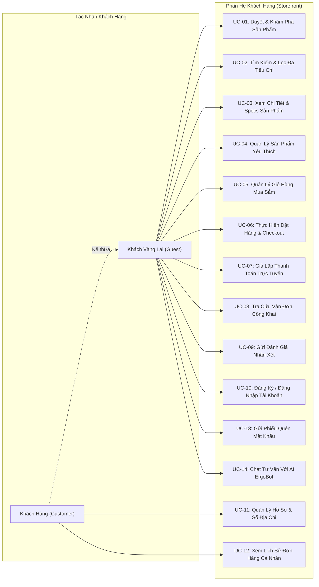
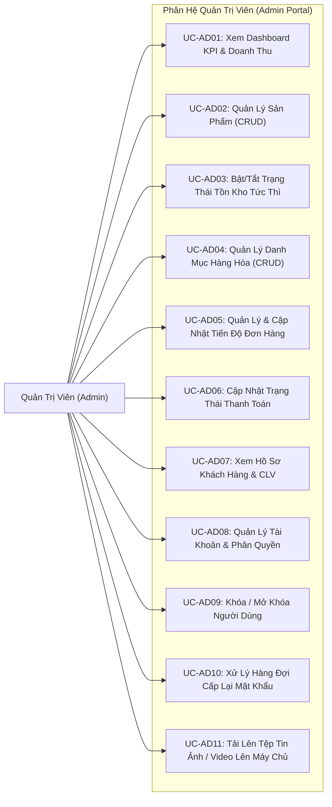

# 📘 TÀI LIỆU TỔNG HỢP CHỨC NĂNG HỆ THỐNG E-COMMERCE ERGOCHAIR
## PHỤC VỤ PHÂN TÍCH VÀ THIẾT KẾ HỆ THỐNG (SOFTWARE REQUIREMENTS SPECIFICATION - SRS)

> **Dự án:** Nền tảng Thương mại Điện tử Ghế Công thái học Cao cấp ErgoChair  
> **Phiên bản tài liệu:** v2.0 (Analysis & System Design Edition)  
> **Mục đích:** Cung cấp bản đặc tả chức năng hoàn chỉnh, tường minh, phân cấp theo tác nhân (Actor) và nghiệp vụ nhằm phục vụ trực tiếp cho việc lập sơ đồ Use Case, thiết kế kiến trúc phần mềm, xây dựng cơ sở dữ liệu và kiểm thử hệ thống.  
> **Nền tảng kỹ thuật:** Next.js 16 App Router, React 19, TypeScript 5, Prisma ORM 6, MySQL / MariaDB, Node.js PBKDF2 SHA-512, Groq AI REST API.

---

## 📑 MỤC LỤC TỔNG HỢP

1. [Tổng Quan & Phân Cấp Tác Nhân Hệ Thống (Actor Profiles)](#1-tổng-quan--phân-cấp-tác-nhân-hệ-thống-actor-profiles)
2. [Ma Trận Phân Quyền & Chức Năng (Role-Permission Matrix / RBAC)](#2-ma-trận-phân-quyền--chức-năng-role-permission-matrix--rbac)
3. [Sơ Đồ Use Case Tổng Thể Hệ Thống (System Use Case Diagrams)](#3-sơ-đồ-use-case-tổng-thể-hệ-thống-system-use-case-diagrams)
4. [Đặc Tả Chức Năng Phân Hệ Khách Hàng (Customer / Storefront Specifications)](#4-đặc-tả-chức-năng-phân-hệ-khách-hàng-customer--storefront-specifications)
   - 4.1. Khám phá & Tìm kiếm Sản phẩm (Catalog & Discovery)
   - 4.2. Xem Chi Tiết & Tương Tác Sản Phẩm (Product Detail & Engagement)
   - 4.3. Quản Lý Danh Sách Yêu Thích (Wishlist Management)
   - 4.4. Giỏ Hàng Mua Sắm (Shopping Cart Management)
   - 4.5. Đặt Hàng & Thanh Toán (Checkout & Transaction Flow)
   - 4.6. Cổng Thanh Toán Trực Tuyến Giả Lập (Payment Gateway Sandbox)
   - 4.7. Tra Cứu & Theo Dõi Hành Trình Đơn Hàng (Order Tracking)
   - 4.8. Đánh Giá & Nhận Xét Sản Phẩm (Product Reviews)
   - 4.9. Quản Lý Tài Khoản & Sổ Địa Chỉ (Customer Account & Address Book)
   - 4.10. Xác Thực & Khôi Phục Quyền Truy Cập (Authentication & Password Recovery)
   - 4.11. Trợ Lý Ảo AI Công Thái Học (AI ErgoBot Assistant)
   - 4.12. Kênh Tư Vấn & Liên Hệ Đa Kênh (Omnichannel Contact & Inquiry)
5. [Đặc Tả Chức Năng Phân Hệ Quản Trị Viên (Admin Portal Specifications)](#5-đặc-tả-chức-năng-phân-hệ-quản-trị-viên-admin-portal-specifications)
   - 5.1. Bảng Điều Khiển Tổng Quan & Chỉ Số KPI (Dashboard & Analytics)
   - 5.2. Quản Lý Sản Phẩm Toàn Diện (Product Lifecycle Management)
   - 5.3. Quản Lý Danh Mục Hàng Hóa (Category Management)
   - 5.4. Quản Lý Vận Đơn & Trạng Thái Đơn Hàng (Order & Logistics Management)
   - 5.5. Quản Lý Hồ Sơ Khách Hàng & CLV (Customer 360 & Lifetime Value)
   - 5.6. Quản Lý Tài Khoản Nhân Sự & Phân Quyền (User & Role Management)
   - 5.7. Xử Lý Yêu Cầu Cấp Lại Mật Khẩu (Password Reset Request Queue)
   - 5.8. Quản Lý Tệp Tin & Đa Phương Tiện Máy Chủ (Media Storage Service)
6. [Ma Trận Tương Tác Thực Thể Dữ Liệu (CRUD Entity Mapping Matrix)](#6-ma-trận-tương-tác-thực-thể-dữ-liệu-crud-entity-mapping-matrix)
7. [Danh Mục Quy Tắc Nghiệp Vụ Cốt Lõi (Business Rules Catalog - BR)](#7-danh-mục-quy-tắc-nghiệp-vụ-cốt-lõi-business-rules-catalog---br)
8. [Yêu Cầu Phi Chức Năng Phục Vụ Thiết Kế Kiến Trúc (Non-Functional Requirements - NFR)](#8-yêu-cầu-phi-chức-năng-phục-vụ-thiết-kế-kiến-trúc-non-functional-requirements---nfr)

---

## 1. TỔNG QUAN & PHÂN CẤP TÁC NHÂN HỆ THỐNG (ACTOR PROFILES)

Hệ thống ErgoChair xác định 4 nhóm tác nhân tham gia vào quy trình nghiệp vụ:

| Mã Tác Nhân | Tên Tác Nhân | Định Nghĩa & Phạm Vi Quyền Hạn | Trạng Thái Phiên |
|---|---|---|---|
| **ACT-01** | **Khách vãng lai (Guest User)** | Người dùng truy cập website nhưng chưa đăng nhập hoặc chưa có tài khoản. Được duyệt danh mục, tìm kiếm, xem chi tiết, thêm giỏ hàng, tra cứu đơn hàng bằng mã/SĐT, gửi phiếu quên mật khẩu và đặt hàng trực tiếp (Guest Checkout). | Phiên ẩn danh (Client LocalStorage) |
| **ACT-02** | **Khách hàng thành viên (Registered Customer)** | Khách hàng đã có tài khoản, đăng nhập thành công. Thừa hưởng mọi quyền của Khách vãng lai và có thêm: Quản lý hồ sơ cá nhân, lưu trữ sổ địa chỉ nhận hàng, xem lịch sử đơn hàng cá nhân, gửi nhận xét có nhãn chứng nhận đã mua hàng (*Verified Purchase*). | Phiên thành viên (`role: customer`, `status: active`) |
| **ACT-03** | **Quản trị viên (System Administrator)** | Cán bộ quản lý kinh doanh, vận hành kho và kỹ thuật hệ thống. Toàn quyền truy cập phân hệ Quản trị (`/admin`): Giám sát KPI doanh thu, toàn quyền CRUD sản phẩm, danh mục, cập nhật tiến độ đơn hàng, quản lý người dùng, xử lý hàng đợi cấp lại mật khẩu. | Phiên quản trị (`role: admin`, `status: active`) |
| **ACT-04** | **Tác nhân Hệ thống & AI (System / AI Engine)** | Tiến trình tự động nền: AI ErgoBot RAG Engine, cơ chế Heuristic Regex Fallback, cơ chế tính cước vận chuyển tự động, cơ chế đồng bộ sự kiện LocalStorage đa tab. | Máy chủ nội bộ / Groq API Background |

---

## 2. MA TRẬN PHÂN QUYỀN & CHỨC NĂNG (ROLE-PERMISSION MATRIX / RBAC)

Ký hiệu:  
- **R (Read):** Xem, tra cứu, hiển thị.  
- **C (Create):** Thêm mới, tạo dữ liệu.  
- **U (Update):** Chỉnh sửa, cập nhật trạng thái.  
- **D (Delete):** Xóa dữ liệu.  
- **- :** Không có quyền truy cập.

| Nhóm Nghiệp Vụ | Chức Năng Cụ Thể | Khách Vãng Lai (Guest) | Khách Hàng (Customer) | Quản Trị Viên (Admin) |
|---|---|:---:|:---:|:---:|
| **Sản phẩm & Danh mục** | Xem danh mục & chi tiết sản phẩm | R | R | R |
| | Tìm kiếm & lọc đa tiêu chí | R | R | R |
| | Thêm mới sản phẩm / danh mục | - | - | C |
| | Sửa thông tin sản phẩm / danh mục | - | - | U |
| | Bật/tắt trạng thái tồn kho tức thì | - | - | U |
| | Xóa sản phẩm / danh mục | - | - | D |
| **Giỏ hàng & Yêu thích** | Thêm/Sửa/Xóa giỏ hàng cá nhân | C, R, U, D | C, R, U, D | C, R, U, D |
| | Thêm/Xóa danh sách yêu thích (Wishlist) | C, R, D | C, R, D | C, R, D |
| **Đơn hàng & Thanh toán** | Đặt hàng mới (Checkout) | C | C | C |
| | Giả lập thanh toán trực tuyến Sandbox | U | U | U |
| | Tra cứu đơn hàng công khai (Order Tracking) | R (qua mã/SĐT) | R (qua mã/SĐT) | R |
| | Xem lịch sử đơn hàng cá nhân | - | R | R |
| | Xem toàn bộ danh sách đơn hàng hệ thống | - | - | R |
| | Cập nhật trạng thái xử lý đơn hàng | - | - | U |
| | Cập nhật trạng thái thanh toán đơn hàng | - | - | U |
| **Đánh giá & Nhận xét** | Xem danh sách đánh giá của sản phẩm | R | R | R |
| | Gửi đánh giá nhận xét mới | C | C (Verified) | C |
| **Tài khoản & Hồ sơ** | Đăng ký tài khoản mới | C | - | C |
| | Đăng nhập hệ thống | R | R | R |
| | Cập nhật hồ sơ cá nhân / Sổ địa chỉ | - | C, R, U, D | C, R, U, D |
| | Đổi mật khẩu cá nhân | - | U | U |
| | Gửi phiếu yêu cầu cấp lại mật khẩu | C | C | - |
| | Quản lý danh sách người dùng toàn hệ thống | - | - | C, R, U, D |
| | Khóa / Mở khóa tài khoản người dùng | - | - | U |
| | Duyệt / Từ chối phiếu cấp lại mật khẩu | - | - | U |
| **Trợ lý Ảo AI** | Trò chuyện, tư vấn ghế & tra đơn với AI | R, C | R, C | R, C |
| **Báo cáo & Thống kê** | Xem Dashboard KPI & Biểu đồ doanh thu | - | - | R |
| **Tệp tin Media** | Upload hình ảnh & video lên máy chủ | - | - | C |

---

## 3. SƠ ĐỒ USE CASE TỔNG THỂ HỆ THỐNG (SYSTEM USE CASE DIAGRAMS)

### 3.1. Sơ Đồ Use Case Phân Hệ Khách Hàng (Storefront)

### 3.2. Sơ Đồ Use Case Phân Hệ Quản Trị Viên (Admin Portal)

---

## 4. ĐẶC TẢ CHỨC NĂNG PHÂN HỆ KHÁCH HÀNG (CUSTOMER / STOREFRONT SPECIFICATIONS)

### 4.1. Khám Phá & Tìm Kiếm Sản Phẩm (Catalog & Discovery)
- **Mã chức năng:** `FE-CAT-01`
- **Mục tiêu:** Cung cấp trải nghiệm tìm kiếm, lọc và phân loại ghế trực quan, giúp khách hàng tìm thấy mẫu ghế mong muốn trong thời gian ngắn nhất.
- **Các thành phần nghiệp vụ chi tiết:**
  1. **Thanh điều hướng toàn trang (Sticky Site Header):**
     - Menu danh mục sản phẩm tự động tải động từ cơ sở dữ liệu MySQL.
     - Biểu tượng Giỏ hàng và Wishlist với huy hiệu (Badge) số lượng đồng bộ thời gian thực.
     - Nút đăng nhập/tài khoản và nút chuyển hướng nhanh sang Admin (nếu tài khoản có vai trò `admin`).
     - Tối ưu hóa giao diện di động bằng Drawer trượt mượt mà.
  2. **Bộ lọc đa thuộc tính thời gian thực (Multi-attribute Realtime Filtering):**
     - *Lọc theo Danh mục:* Lấy từ bảng `Category` (Ghế công thái học, Ghế văn phòng, Ghế gaming, Ghế lãnh đạo...).
     - *Lọc theo 4 khoảng giá định trước:* Dưới 5 triệu, Từ 5 - 8 triệu, Từ 8 - 12 triệu, Trên 12 triệu VNĐ.
     - *Lọc theo tình trạng tồn kho:* Tất cả / Còn hàng (`in-stock`) / Tạm hết hàng (`out-of-stock`).
     - *Sắp xếp sản phẩm (Sorting):* Nổi bật nhất, Giá tăng dần, Giá giảm dần, Đánh giá sao cao nhất.
  3. **Đồng bộ trạng thái bộ lọc lên URL:**
     - Sử dụng `window.history.replaceState` lưu các tham số lọc vào URL Search Params mà không gây giật lag hay reload trang, hỗ trợ copy link chia sẻ kết quả lọc.
  4. **Tìm kiếm tức thì hỗ trợ tiếng Việt không dấu (Vietnamese Instant Search):**
     - Chuẩn hóa chuỗi bằng hàm `normalizeSearchText` (loại bỏ dấu thanh, chuyển đổi `đ/Đ` -> `d`), hỗ trợ người dùng tìm kiếm chính xác dù gõ có dấu hay không dấu.
  5. **Cơ chế cuộn trang gia tốc mềm mại (Custom Easing Smooth Scroll):**
     - Khi chuyển từ trang chủ vào danh mục, kích hoạt hiệu ứng cuộn chậm gia tốc `easeInOutCubic` trong thời lượng `900ms`, tự động bù trừ chiều cao Fixed Header (`94px` trên desktop, `76px` trên mobile).

### 4.2. Xem Chi Tiết & Tương Tác Sản Phẩm (Product Detail & Engagement)
- **Mã chức năng:** `FE-PRD-01`
- **Mục tiêu:** Cung cấp đầy đủ thông số kỹ thuật, hình ảnh thực tế và kiểm soát nghiệp vụ mua bán chặt chẽ.
- **Các thành phần nghiệp vụ chi tiết:**
  1. **Bộ sưu tập đa phương tiện (Rich Media Gallery):**
     - Hỗ trợ hiển thị tới 5 góc chụp ảnh sản phẩm (ảnh chính + 4 ảnh chi tiết).
     - Hỗ trợ trình phát video sản phẩm trực tiếp (video tải lên máy chủ hoặc nhúng video YouTube).
  2. **Bảng thông số kỹ thuật đa chiều (Specs Table):**
     - Hiển thị kích thước thực tế (Dài × Rộng × Cao cm), chất liệu khung & lưới, màu sắc, tải trọng tối đa (kg), trọng lượng (kg), thời hạn bảo hành.
  3. **Bộ điều khiển số lượng & cơ chế khóa tồn kho (Stock Guard):**
     - Bộ chọn số lượng `[ - ] [ Số lượng ] [ + ]`.
     - Nút "Thêm vào giỏ hàng" và nút "Mua ngay" chuyển thẳng sang checkout.
     - **Quy tắc khi sản phẩm tạm hết hàng (`inStock = false` hoặc `stockQuantity = 0`):**
       - Khóa ô số lượng về `0` (disabled).
       - Khóa nút "Thêm vào giỏ" và đổi nhãn thành "Tạm hết hàng".
       - Chuyển đổi nút "Mua ngay" thành nút tiện ích "Liên hệ tư vấn →" chuyển hướng sang bộ phận CSKH.
       - Tầng CartContext chặn tuyệt đối hành vi thêm sản phẩm hết hàng vào bộ nhớ.
  4. **Khối sản phẩm đã xem gần đây (Recently Viewed Tracker):**
     - Tự động lưu vết ID các sản phẩm vừa xem vào `localStorage` và hiển thị băng chuyền ở chân trang để người dùng tiện so sánh.

### 4.3. Quản Lý Danh Sách Yêu Thích (Wishlist Management)
- **Mã chức năng:** `FE-WSH-01`
- **Mục tiêu:** Cho phép khách hàng lưu lại các mẫu ghế quan tâm để cân nhắc mua sau.
- **Các thành phần nghiệp vụ chi tiết:**
  - Nút biểu tượng trái tim trên thẻ sản phẩm và trang chi tiết: Nhấn để thêm/bỏ thích với hiệu ứng chuyển đổi tức thì.
  - Trang quản lý Wishlist (`/wishlist`): Xem toàn bộ ghế đã lưu, hiển thị giá bán và tình trạng tồn kho.
  - Thao tác nhanh: Nút "Thêm vào giỏ" trực tiếp từ trang Wishlist, nút "Xóa khỏi yêu thích", nút "Xóa toàn bộ danh sách".
  - Lưu trữ bền vững qua `WishlistContext` và đồng bộ `localStorage` (`ergochair-wishlist`).

### 4.4. Giỏ Hàng Mua Sắm (Shopping Cart Management)
- **Mã chức năng:** `FE-CRT-01`
- **Mục tiêu:** Quản lý danh sách các mặt hàng người dùng dự định mua sắm trước khi thanh toán.
- **Các thành phần nghiệp vụ chi tiết:**
  - Hiển thị chi tiết từng món: Ảnh đại diện, danh mục, tên sản phẩm, đơn giá, số lượng và tổng tiền từng dòng.
  - Tăng/giảm số lượng tức thì; tự động xóa sản phẩm nếu số lượng giảm về `0`.
  - Nút "Xóa" từng dòng và nút xóa toàn bộ giỏ hàng.
  - Tự động tính toán tổng tiền tạm tính (Subtotal) và phí vận chuyển tiêu chuẩn.
  - Lưu trữ liên tục trong `localStorage` (`ergochair-cart`), bảo toàn dữ liệu khi F5 hoặc mở lại trình duyệt.
  - Màn hình thông báo tinh tế khi giỏ trống kèm nút kêu gọi hành động "Khám phá sản phẩm →".

### 4.5. Đặt Hàng & Thanh Toán (Checkout & Transaction Flow)
- **Mã chức năng:** `FE-CHK-01`
- **Mục tiêu:** Thu thập thông tin giao nhận, phương thức vận chuyển và thanh toán để tạo đơn hàng hợp lệ.
- **Các thành phần nghiệp vụ chi tiết:**
  1. **Biểu mẫu thông tin giao hàng chuẩn Việt Nam:**
     - Họ tên người nhận.
     - Số điện thoại người nhận (Validation định dạng số di động Việt Nam: từ 9 đến 11 chữ số).
     - Email nhận hóa đơn và thông báo xác nhận.
     - Địa chỉ chi tiết (Số nhà, tên đường).
     - Tỉnh / Thành phố: Dropdown chọn trong danh sách 63 tỉnh thành Việt Nam.
     - Quận / Huyện: Tự động cập nhật danh sách theo tỉnh thành được chọn.
     - Ghi chú giao hàng (hướng dẫn giao cho bảo vệ, giờ giao...).
  2. **Tự động điền từ Sổ địa chỉ (Address Auto-fill):**
     - Nếu khách hàng đã đăng nhập, hệ thống tự động tải địa chỉ mặc định từ hồ sơ cá nhân giúp hoàn tất đơn hàng nhanh chóng.
  3. **Lựa chọn 3 phương thức vận chuyển:**
     - *Giao hàng tiêu chuẩn (Standard):* Phí tiêu chuẩn 30.000đ (miễn phí khi đạt giá trị đơn quy định).
     - *Giao hàng hỏa tốc 2H (Express):* Áp dụng cước cố định 60.000đ.
     - *Giao hàng & Lắp đặt tận phòng (ErgoCare Assembly):* Cước 50.000đ hoặc 120.000đ tùy giá trị đơn.
  4. **Lựa chọn 4 phương thức thanh toán:**
     - Thanh toán khi nhận hàng (COD).
     - Chuyển khoản ngân hàng (Bank Transfer / VietQR).
     - Cổng thanh toán trực tuyến VNPAY.
     - Ví điện tử MoMo.
  5. **Tạo đơn hàng & Điều hướng:**
     - Sau khi gửi biểu mẫu thành công: Gọi API `POST /api/orders` khởi tạo đơn, trừ tồn kho và sinh mã vận đơn tự động.
     - Nếu chọn COD: Chuyển hướng thẳng sang trang thành công `/order-success?orderId=...`.
     - Nếu chọn Online (Bank / VNPAY / MoMo): Chuyển hướng sang cổng thanh toán giả lập `/checkout/payment?orderId=...`.

### 4.6. Cổng Thanh Toán Trực Tuyến Giả Lập (Payment Gateway Sandbox)
- **Mã chức năng:** `FE-PAY-01`
- **Mục tiêu:** Giả lập môi trường xử lý thanh toán điện tử an toàn cho mục đích kiểm thử và demo nghiệm thu quy trình.
- **Các thành phần nghiệp vụ chi tiết:**
  - Tuyến đường dẫn: `/checkout/payment`.
  - Hiển thị mã đơn hàng, số tiền cần thanh toán và mã QR tương ứng theo phương thức đã chọn:
    - *VietQR:* Hiển thị mã QR ngân hàng kèm số tài khoản và cú pháp chuyển khoản tự động.
    - *VNPAY:* Giao diện quét mã VNPAY-QR giả lập.
    - *MoMo:* Giao diện quét mã ví MoMo giả lập.
  - Tích hợp 2 nút kiểm thử kịch bản:
    - "Xác nhận đã thanh toán thành công (Sandbox)" -> Gọi API `/api/orders/[id]/pay` cập nhật `paymentStatus = "paid"` và chuyển sang `/order-success`.
    - "Hủy / Thanh toán thất bại" -> Thông báo lỗi và cho phép chọn lại phương thức thanh toán.

### 4.7. Tra Cứu & Theo Dõi Hành Trình Đơn Hàng (Order Tracking)
- **Mã chức năng:** `FE-TRK-01`
- **Mục tiêu:** Cung cấp kênh tra cứu tiến độ vận chuyển minh bạch cho mọi khách hàng mà không bắt buộc phải đăng nhập.
- **Các thành phần nghiệp vụ chi tiết:**
  - Tuyến đường dẫn: `/orders` (kết nối API `GET /api/orders/track`).
  - Cho phép tra cứu bằng 1 trong 3 thông tin: Mã đơn hàng (`ord-xxx`), Mã vận đơn (`GHTK-xxx`) hoặc Số điện thoại người nhận.
  - Hiển thị trục thời gian (Timeline) 5 mốc xử lý đơn:
    1. Đã tiếp nhận đơn hàng.
    2. Đang xử lý & đóng gói tại kho.
    3. Bàn giao đơn vị vận chuyển & Đang giao hàng.
    4. Giao hàng thành công.
    5. Đã hủy đơn (nếu phát sinh).
  - Hiển thị chi tiết đơn vị vận chuyển, trạng thái thanh toán, địa chỉ người nhận và danh sách sản phẩm trong đơn.

### 4.8. Đánh Giá & Nhận Xét Sản Phẩm (Product Reviews)
- **Mã chức năng:** `FE-REV-01`
- **Mục tiêu:** Thu thập và hiển thị phản hồi xã hội thực tế từ người dùng nhằm tăng độ uy tín thương hiệu.
- **Các thành phần nghiệp vụ chi tiết:**
  - Thống kê tổng quan: Điểm sao trung bình / 5.0, tổng lượt đánh giá, biểu đồ phần trăm phân bổ 5 sao -> 1 sao.
  - Bộ lọc xem nhận xét theo số sao (Tất cả, 5 sao, 4 sao...).
  - Nhãn xác thực *"Đã mua hàng tại ErgoChair"* (Verified Purchase): Tự động gán khi tài khoản đã có đơn hàng thành công chứa sản phẩm này.
  - Biểu mẫu gửi đánh giá: Chọn số sao bằng click chuột (1-5 sao), nhập họ tên, chức danh nghề nghiệp, nội dung nhận xét và gửi lưu trực tiếp vào bảng `Review` trong cơ sở dữ liệu.

### 4.9. Quản Lý Tài Khoản & Sổ Địa Chỉ (Customer Account & Address Book)
- **Mã chức năng:** `FE-ACC-01`
- **Mục tiêu:** Cho phép khách hàng quản lý thông tin định danh, sổ địa chỉ nhận hàng và lịch sử mua sắm cá nhân.
- **Các thành phần nghiệp vụ chi tiết:**
  - Tuyến đường dẫn: `/account`.
  - **Thông tin cá nhân:** Xem họ tên, email, số điện thoại, ngày tham gia; cập nhật hồ sơ cá nhân.
  - **Đổi mật khẩu:** Nhập mật khẩu hiện tại, nhập mật khẩu mới (tối thiểu 6 ký tự), xác nhận mật khẩu; hệ thống xác thực mật khẩu cũ và băm mật khẩu mới bằng PBKDF2 SHA-512.
  - **Sổ địa chỉ giao hàng đa điểm (Address Book):**
    - Thêm địa chỉ mới (Tên người nhận, SĐT, Địa chỉ, Tỉnh/Thành phố, Quận/Huyện).
    - Đặt địa chỉ làm "Địa chỉ mặc định" (Default Address).
    - Chỉnh sửa và xóa địa chỉ không còn sử dụng.
  - **Lịch sử đơn hàng cá nhân:** Xem toàn bộ các đơn hàng do tài khoản đã đặt, lọc theo trạng thái, xem chi tiết từng đơn hàng và trạng thái vận chuyển.

### 4.10. Xác Thực & Khôi Phục Quyền Truy Cập (Authentication & Password Recovery)
- **Mã chức năng:** `FE-AUT-01`
- **Mục tiêu:** Đảm bảo an toàn truy cập và hỗ trợ khôi phục quyền sử dụng tài khoản khi người dùng quên mật khẩu.
- **Các thành phần nghiệp vụ chi tiết:**
  - **Đăng ký tài khoản (`/register`):** Nhập họ tên, email, số điện thoại, mật khẩu; kiểm tra trùng lặp email trên database, tự động băm mật khẩu bằng PBKDF2 SHA-512 với muối 16 byte ngẫu nhiên.
  - **Đăng nhập (`/login`):** Xác thực email và mật khẩu; kiểm tra trạng thái tài khoản (chặn ngay lập tức nếu trạng thái là `blocked`); lưu phiên vào `localStorage` và phát sự kiện đồng bộ đa tab.
  - **Đăng xuất:** Xóa dữ liệu phiên khỏi `localStorage`, phát sự kiện `ergochair-auth-change` để đưa toàn bộ giao diện về trạng thái khách vãng lai.
  - **Yêu cầu cấp lại mật khẩu (`/login` - Tab Quên mật khẩu):**
    - Người dùng nhập Email và Số điện thoại đã đăng ký, kèm ghi chú yêu cầu.
    - Gọi API `POST /api/auth/forgot-password` ghi nhận phiếu yêu cầu vào bảng `PasswordResetRequest` trong cơ sở dữ liệu với trạng thái `pending` để chờ Quản trị viên phê duyệt.

### 4.11. Trợ Lý Ảo AI Công Thái Học (AI ErgoBot Assistant)
- **Mã chức năng:** `FE-BOT-01`
- **Mục tiêu:** Cung cấp dịch vụ chăm sóc khách hàng tự động 24/7 thông qua kiến trúc RAG kết hợp LLM và suy luận dữ liệu nội bộ.
- **Các thành phần nghiệp vụ chi tiết:**
  - Nút Widget nổi ở góc dưới màn hình: Mở hộp thoại chat với câu chào thông minh và các nút gợi ý câu hỏi mẫu.
  - **Phân loại 8 ý định người dùng (Intents):**
    1. `TRACK_ORDER`: Tra cứu đơn hàng theo mã đơn, mã vận đơn hoặc số điện thoại.
    2. `SEARCH_PRODUCT`: Tìm ghế theo chiều cao (cm), cân nặng (kg), ngân sách hoặc chất liệu (lưới/da).
    3. `PRODUCT_DETAIL`: Hỏi sâu về thông số, tính năng ngả lưng, piston nâng hạ của một mẫu ghế cụ thể.
    4. `WARRANTY_POLICY`: Hỏi về thời gian bảo hành (3-5 năm), chính sách đổi trả (30 ngày).
    5. `SHIPPING_POLICY`: Hỏi về phí ship, giao hỏa tốc 2H, giao lắp tận phòng.
    6. `DISCOUNT_INQUIRY`: Hỏi về mã giảm giá, voucher, khuyến mãi hiện hành.
    7. `PRODUCT_REVIEW`: Hỏi về nhận xét của khách hàng đã mua về sản phẩm.
    8. `GENERAL_QA`: Chào hỏi, cảm ơn hoặc câu hỏi thông thường.
  - **Cơ chế dự phòng kép:** Kết nối Groq LLM qua REST API với giới hạn thời gian chờ 3.5s; tự động chuyển sang bộ máy Heuristic Regex nội bộ nếu mất mạng hoặc API bên ngoài gặp sự cố, đảm bảo 100% thời gian hoạt động.
  - **Gợi ý thẻ sản phẩm tương tác:** Trả về tin nhắn kèm thẻ sản phẩm bấm vào xem ngay chi tiết hoặc thêm giỏ hàng.

### 4.12. Kênh Tư Vấn & Liên Hệ Đa Kênh (Omnichannel Contact & Inquiry)
- **Mã chức năng:** `FE-CNT-01`
- **Mục tiêu:** Tạo kênh kết nối trực tiếp giữa khách hàng với đội ngũ tư vấn viên của thương hiệu.
- **Các thành phần nghiệp vụ chi tiết:**
  - Widget liên hệ nổi (Floating Contact Widget): Nút gọi nhanh Hotline, liên kết Zalo CSKH chính thức và Messenger fanpage.
  - Trang Giới thiệu (`/about`): Tôn chỉ thiết kế, giá trị cốt lõi công thái học và sứ mệnh bảo vệ cột sống.
  - Trang Liên hệ (`/contact`): Bản đồ showroom, địa chỉ trụ sở, số điện thoại hotline, email hỗ trợ và biểu mẫu gửi thắc mắc trực tuyến.

---

## 5. ĐẶC TẢ CHỨC NĂNG PHÂN HỆ QUẢN TRỊ VIÊN (ADMIN PORTAL SPECIFICATIONS)

### 5.1. Bảng Điều Khiển Tổng Quan & Chỉ Số KPI (Dashboard & Analytics)
- **Mã chức năng:** `AD-DSH-01`
- **Mục tiêu:** Cung cấp bức tranh toàn cảnh về sức khỏe kinh doanh và vận hành hệ thống trong thời gian thực.
- **Tuyến đường dẫn:** `/admin`
- **Các thành phần nghiệp vụ chi tiết:**
  1. **4 thẻ chỉ số KPI cốt lõi (Summary KPI Cards):**
     - *Tổng doanh thu thực tế:* Tự động cộng tổng tiền của toàn bộ đơn hàng hợp lệ từ MySQL (tự động loại trừ các đơn có trạng thái `cancelled`).
     - *Tổng đơn hàng:* Tổng số đơn tiếp nhận, kèm thống kê phân loại chi tiết số lượng đơn theo 5 trạng thái (Chờ duyệt, Đang đóng gói, Đang giao, Hoàn tất, Đã hủy).
     - *Tổng sản phẩm:* Số lượng mã sản phẩm đang quản lý, kèm phân loại số lượng *Còn hàng* và *Tạm hết hàng*.
     - *Tổng người dùng:* Tổng số tài khoản khách hàng và nhân sự trên toàn hệ thống.
  2. **Biểu đồ sóng doanh thu 7 ngày gần nhất (Interactive Revenue Chart):**
     - Tổng hợp dữ liệu tài chính theo từng ngày trong tuần gần nhất từ bảng `Order`.
     - Tương tác di chuột hiển thị chính xác ngày và doanh thu đạt được.
  3. **Bảng đơn hàng mới tiếp nhận:**
     - Hiển thị danh sách các đơn hàng vừa phát sinh với mã đơn, tên khách hàng, tổng tiền và trạng thái xử lý tức thời.
  4. **Bảng Top sản phẩm bán chạy nhất:**
     - Thống kê các mẫu ghế có số lượng bán và doanh thu cao nhất để hỗ trợ kế hoạch nhập hàng.

### 5.2. Quản Lý Sản Phẩm Toàn Diện (Product Lifecycle Management)
- **Mã chức năng:** `AD-PRD-01`
- **Mục tiêu:** Quản trị toàn bộ danh mục sản phẩm, kiểm soát thông tin kỹ thuật, hình ảnh, video và tồn kho.
- **Tuyến đường dẫn:** `/admin/products`
- **Các thành phần nghiệp vụ chi tiết:**
  1. **Danh sách sản phẩm dạng bảng:**
     - Xem ảnh đại diện, mã slug, tên ghế, danh mục, giá niêm yết, giá so sánh cũ, tồn kho và trạng thái.
     - Tìm kiếm theo tên hoặc danh mục; lọc theo danh mục và lọc theo tình trạng tồn kho.
  2. **Công tắc gạt tồn kho tức thì (Instant InStock Toggle):**
     - Nút chuyển trạng thái `Còn hàng` <-> `Tạm hết hàng` chỉ với 1 click ngay trên bảng danh sách; hệ thống tự động gọi API cập nhật MySQL và đồng bộ ngay ra giao diện người dùng mà không cần mở modal sửa.
  3. **Modal thêm mới & chỉnh sửa sản phẩm chuyên sâu (1.291 dòng code):**
     - *Thông tin cơ bản:* Tên sản phẩm, slug đường dẫn, chọn danh mục từ danh mục động, giá bán ưu đãi (VNĐ), giá niêm yết so sánh cũ, số lượng tồn kho (`stockQuantity`).
     - *Tải lên 5 slot ảnh sản phẩm:* Tải ảnh trực tiếp lên máy chủ qua API `/api/upload` (hỗ trợ JPG, PNG, WebP) với cơ chế chuẩn hóa tên file an toàn; chọn ảnh bìa chính và 4 ảnh góc chụp chi tiết.
     - *Tải lên & Nhúng Video sản phẩm:* Hỗ trợ upload video MP4 lên máy chủ hoặc dán liên kết video YouTube tự động nhận dạng.
     - *Kích thước sản phẩm đa chiều:* Nhập riêng 3 trường Chiều dài, Chiều rộng, Chiều cao (cm), tự động định dạng chuẩn hiển thị (VD: `68 × 68 × 115-125 cm`).
     - *Thông số kỹ thuật chi tiết:* Chất liệu khung/lưới, màu sắc hoàn thiện, tải trọng tối đa (kg), trọng lượng (kg), thời hạn bảo hành (năm) và mô tả chi tiết sản phẩm.
  4. **Xóa sản phẩm an toàn (Safe Deletion Guard):**
     - Modal cảnh báo xác nhận xóa sản phẩm: Ngăn chặn thao tác bấm nhầm; kiểm tra ràng buộc toàn vẹn khóa ngoại trong cơ sở dữ liệu.

### 5.3. Quản Lý Danh Mục Hàng Hóa (Category Management)
- **Mã chức năng:** `AD-CAT-01`
- **Mục tiêu:** Quản lý các nhóm danh mục phân loại ghế công thái học.
- **Tuyến đường dẫn:** `/admin/categories`
- **Các thành phần nghiệp vụ chi tiết:**
  - Xem danh sách danh mục: Hiển thị tên danh mục, mã định danh, slug đường dẫn và số lượng sản phẩm đang thuộc danh mục đó.
  - Thêm mới danh mục: Nhập tên danh mục, hệ thống tự động sinh slug tiếng Việt không dấu chuẩn SEO.
  - Sửa tên & cập nhật thông tin danh mục.
  - Xóa danh mục không còn sử dụng kèm xác nhận an toàn.
  - **Cơ chế phát sự kiện đồng bộ toàn cục:** Khi danh mục thay đổi, hệ thống phát Custom DOM Event `ergochair-categories-change`, cập nhật danh sách menu Header phía khách hàng ngay lập tức mà không cần F5 trình duyệt.

### 5.4. Quản Lý Vận Đơn & Trạng Thái Đơn Hàng (Order & Logistics Management)
- **Mã chức năng:** `AD-ORD-01`
- **Mục tiêu:** Quản trị quy trình đóng gói, giao vận và đối soát thanh toán đơn hàng.
- **Tuyến đường dẫn:** `/admin/orders`
- **Các thành phần nghiệp vụ chi tiết:**
  1. **Bộ lọc đơn hàng đa chiều:**
     - Lọc theo 5 trạng thái vòng đời đơn hàng:
       - `pending`: Đơn hàng mới chờ xác nhận.
       - `processing`: Đang xử lý đóng gói tại kho.
       - `shipped`: Đã xuất kho & đang vận chuyển.
       - `completed`: Giao hàng thành công & hoàn tất.
       - `cancelled`: Đơn hàng đã hủy.
     - Tìm kiếm theo Mã đơn hàng (`ord-xxx`), Họ tên khách hàng, Số điện thoại hoặc Email người nhận.
  2. **Cập nhật nhanh trạng thái đơn hàng (Quick Status Switch):**
     - Dropdown đổi trạng thái trực tiếp trên từng dòng với cơ chế cập nhật giao diện Optimistic mượt mà.
  3. **Cập nhật trạng thái thanh toán (Payment Status Toggle):**
     - Chuyển đổi trạng thái giữa `unpaid` (Chưa thanh toán) và `paid` (Đã thanh toán) để đối soát dòng tiền.
  4. **Modal xem chi tiết đơn hàng toàn diện:**
     - Hiển thị đầy đủ thông tin người nhận: Họ tên, điện thoại, email, địa chỉ giao hàng và ghi chú.
     - Thông tin đơn vị vận chuyển (GHTK, Viettel Post, Ahamove...), mã vận đơn (`trackingCode`), gói cước giao hàng.
     - Bảng danh sách sản phẩm trong đơn: Ảnh thu nhỏ, tên sản phẩm, số lượng, đơn giá và thành tiền.
     - Tóm tắt tài chính: Tạm tính, phí vận chuyển, chiết khấu giảm giá và tổng thanh toán.
     - Chức năng in phiếu đơn hàng / xuất phiếu giao vận cho nhân viên kho.

### 5.5. Quản Lý Hồ Sơ Khách Hàng & CLV (Customer 360 & Lifetime Value)
- **Mã chức năng:** `AD-CST-01`
- **Mục tiêu:** Thấu hiểu hành vi khách hàng, theo dõi giá trị vòng đời và quản lý quyền truy cập của người mua.
- **Tuyến đường dẫn:** `/admin/customers`
- **Các thành phần nghiệp vụ chi tiết:**
  - Bảng danh sách khách hàng: Tên, email, số điện thoại, ngày đăng ký, trạng thái hoạt động.
  - **Góc nhìn khách hàng toàn diện (Customer 360 View Modal):**
    - Thông tin cá nhân và ngày tạo tài khoản.
    - Sổ danh sách tất cả các địa chỉ giao hàng đã lưu của khách.
    - **Tổng giá trị chi tiêu tích lũy (Customer Lifetime Value - CLV):** Tự động tính toán tổng số tiền khách đã chi trả qua tất cả các đơn hàng hoàn tất.
    - Danh sách toàn bộ lịch sử đơn hàng khách đã từng đặt tại hệ thống.
  - **Khóa / Mở khóa tài khoản khách hàng:** Nút gạt chuyển trạng thái `active` <-> `blocked`. Khi bị khóa, tài khoản lập tức bị từ chối truy cập và bị hủy phiên đăng nhập trên toàn bộ thiết bị.

### 5.6. Quản Lý Tài Khoản Nhân Sự & Phân Quyền (User & Role Management)
- **Mã chức năng:** `AD-USR-01`
- **Mục tiêu:** Quản trị danh sách tài khoản nội bộ và khách hàng trên hệ thống.
- **Tuyến đường dẫn:** `/admin/users` (kết nối trực tiếp component hợp nhất `AdminCustomersPage`).
- **Các thành phần nghiệp vụ chi tiết:**
  - Xem danh sách toàn bộ tài khoản, lọc theo vai trò (`admin` / `customer`) và trạng thái (`active` / `blocked`).
  - **Tạo mới tài khoản:** Tạo tài khoản trực tiếp, phân quyền vai trò (`admin` hoặc `customer`), thiết lập mật khẩu ban đầu và trạng thái hoạt động.
  - **Chỉnh sửa tài khoản:** Đổi họ tên, số điện thoại, thay đổi phân quyền vai trò.
  - **Đặt lại mật khẩu trực tiếp (Direct Password Reset):** Quản trị viên có thể nhập mật khẩu mới trực tiếp cho người dùng trong các trường hợp hỗ trợ khẩn cấp; mật khẩu được tự động băm bằng PBKDF2 SHA-512 trước khi lưu MySQL.
  - **Xóa tài khoản an toàn & Cơ chế bảo vệ Admin (Self-deletion Guard):** Hệ thống chặn tuyệt đối hành vi Quản trị viên tự xóa tài khoản của chính mình để tránh mất quyền quản trị hệ thống.

### 5.7. Xử Lý Yêu Cầu Cấp Lại Mật Khẩu (Password Reset Request Queue)
- **Mã chức năng:** `AD-RST-01`
- **Mục tiêu:** Hàng đợi tiếp nhận và phê duyệt yêu cầu khôi phục mật khẩu từ khách hàng một cách an toàn và có kiểm soát.
- **Tuyến đường dẫn:** Tab "Password Resets" trong `/admin/customers` (kết nối API `/api/admin/password-resets`).
- **Các thành phần nghiệp vụ chi tiết:**
  - Tiếp nhận danh sách các phiếu yêu cầu quên mật khẩu gửi từ màn hình đăng nhập phía người dùng.
  - Lọc phiếu theo 3 trạng thái: `pending` (Chờ xử lý), `completed` (Đã duyệt), `rejected` (Đã từ chối).
  - Xem thông tin chi tiết: Email, Số điện thoại người yêu cầu, thời gian gửi và ghi chú.
  - **Quy trình phê duyệt & cấp mật khẩu mới:**
    - Tự động sinh mật khẩu ngẫu nhiên có độ phức tạp cao (hoặc Admin tự nhập mật khẩu mới chỉ định).
    - Nhập ghi chú phản hồi của Admin.
    - Bấm "Phê duyệt & Cấp mật khẩu": Hệ thống tự động băm mật khẩu mới bằng PBKDF2 SHA-512, cập nhật vào tài khoản tương ứng trong bảng `User`, chuyển trạng thái phiếu sang `completed`.
    - Hiển thị hộp thoại chứa mật khẩu mới và nút "Copy" một chạm để Quản trị viên gửi lại cho khách hàng qua kênh liên lạc chính thức (Email/Zalo/SMS).
  - **Quy trình từ chối yêu cầu:** Bấm "Từ chối" kèm ghi chú lý do (VD: Thông tin số điện thoại không khớp hồ sơ đăng ký) và chuyển trạng thái phiếu sang `rejected`.

### 5.8. Quản Lý Tệp Tin & Đa Phương Tiện Máy Chủ (Media Storage Service)
- **Mã chức năng:** `AD-MED-01`
- **Mục tiêu:** Lưu trữ và quản lý tài nguyên hình ảnh, video sản phẩm được tải lên máy chủ.
- **Tuyến đường dẫn:** API `/api/upload` (thư mục lưu trữ `public/uploads/`).
- **Các thành phần nghiệp vụ chi tiết:**
  - Hỗ trợ định dạng hình ảnh (JPG, PNG, WebP) và video (MP4) dung lượng tối đa 50MB.
  - **Cơ chế khử dấu tiếng Việt & bảo vệ tên tệp (Safe Filename Sanitizer):**
    - Tự động chuyển đổi tiếng Việt có dấu sang không dấu (VD: `anh-ghe-cong-thai-hoc.jpg`).
    - Loại bỏ ký tự đặc biệt lạ, thay khoảng trắng bằng dấu gạch ngang `-`.
    - Gắn thêm nhãn thời gian Unix timestamp vào tên file để ngăn chặn ghi đè tệp tin có sẵn và phòng chống lỗ hổng bảo mật tệp tin.

---

## 6. MA TRẬN TƯƠNG TÁC THỰC THỂ DỮ LIỆU (CRUD ENTITY MAPPING MATRIX)

Bảng đối chiếu giữa các chức năng nghiệp vụ và các bảng dữ liệu trong cơ sở dữ liệu MySQL (thông qua Prisma ORM):

| Thực Thể (Entity / Table) | Chức Năng Đọc (Read) | Chức Năng Tạo Mới (Create) | Chức Năng Cập Nhật (Update) | Chức Năng Xóa (Delete) |
|---|---|---|---|---|
| **User** | Đăng nhập, Profile, Admin Users, Admin Customers, AI RAG | Đăng ký, Admin tạo tài khoản | Đổi thông tin, Đổi mật khẩu, Khóa/Mở khóa, Admin Reset Pass | Admin xóa tài khoản |
| **Product** | Danh mục, Chi tiết sản phẩm, Giỏ hàng, Đơn hàng, AI RAG, Admin Products | Admin thêm sản phẩm mới | Admin sửa sản phẩm, Toggle tồn kho, Trừ kho khi đặt hàng | Admin xóa sản phẩm |
| **Category** | Menu Header, Bộ lọc Catalog, Chi tiết sản phẩm, Admin Categories | Admin thêm danh mục | Admin sửa danh mục | Admin xóa danh mục |
| **Order** | Tra cứu đơn hàng, Lịch sử đơn cá nhân, Admin Orders, Admin Dashboard, AI RAG | Khách hàng đặt hàng (Checkout) | Đổi trạng thái đơn, Cập nhật thanh toán Sandbox/Admin | - (Chỉ chuyển trạng thái `cancelled`) |
| **OrderItem** | Chi tiết đơn hàng, Tra cứu vận đơn, Admin chi tiết đơn, AI RAG | Tự động tạo cùng Order khi Checkout | - | Xóa liên đới theo Cascade khi xóa Order |
| **Review** | Trang chi tiết sản phẩm, Thống kê sao trung bình, AI RAG | Khách hàng gửi đánh giá mới | - | - |
| **Coupon** | Kiểm tra mã ưu đãi `/api/coupons/validate`, AI RAG | Khởi tạo từ Prisma Seed / Backend | Tăng số lượt đã dùng (`usedCount`) khi đặt hàng | - |
| **PasswordResetRequest** | Admin hàng đợi Reset Password | Khách gửi phiếu yêu cầu từ màn hình login | Admin phê duyệt (`completed`) hoặc từ chối (`rejected`) | - |

---

## 7. DANH MỤC QUY TẮC NGHIỆP VỤ CỐT LÕI (BUSINESS RULES CATALOG - BR)

Các quy tắc ràng buộc logic mà bất kỳ giai đoạn phát triển hay mở rộng nào cũng phải tuân thủ nghiêm ngặt:

- **BR-01 (Toàn vẹn tồn kho khi mua hàng):**  
  Chỉ những sản phẩm có `inStock = true` và `stockQuantity > 0` mới được phép thêm vào giỏ hàng hoặc đặt mua. Nếu sản phẩm hết hàng, hệ thống phải vô hiệu hóa nút mua và chuyển hướng sang tư vấn đặt trước.
- **BR-02 (Bảo mật băm mật khẩu PBKDF2):**  
  Mọi mật khẩu người dùng lưu trữ trong cơ sở dữ liệu phải được băm bằng PBKDF2 SHA-512 với 1.000 iterations và muối ngẫu nhiên 16 bytes. Không được phép lưu trữ mật khẩu dưới dạng văn bản thuần (plain text).
- **BR-03 (Khóa truy cập tức thời tài khoản Blocked):**  
  Tài khoản có trạng thái `status = "blocked"` bị chặn đăng nhập ngay tại tầng xác thực API. Nếu tài khoản bị khóa khi đang hoạt động, cơ chế kiểm tra `/api/auth/me` sẽ thu hồi phiên ngay lập tức.
- **BR-04 (Tự bảo vệ tài khoản Quản trị viên):**  
  Quản trị viên không thể tự xóa tài khoản của chính mình trong màn hình quản lý người dùng để ngăn chặn sự cố mất quyền điều hành hệ thống.
- **BR-05 (Ràng buộc chuyển đổi trạng thái đơn hàng):**  
  Trạng thái đơn hàng di chuyển theo một chiều logic: `pending` ➔ `processing` ➔ `shipped` ➔ `completed`. Đơn hàng ở trạng thái `cancelled` không thể quay lại trạng thái xử lý và không được tính vào tổng doanh thu KPI.
- **BR-06 (Thời gian chờ tối đa của AI ErgoBot):**  
  Mọi truy vấn tới Groq API bị giới hạn thời gian chờ tối đa 3.500ms thông qua `AbortController`. Nếu vượt quá thời gian này hoặc xảy ra sự cố mạng, hệ thống bắt buộc phải tự động kích hoạt bộ máy Heuristic Regex Fallback nội bộ để phản hồi khách hàng ngay lập tức.
- **BR-07 (Chuẩn hóa tệp tin tải lên):**  
  Mọi tệp tin hình ảnh/video tải lên máy chủ bắt buộc phải được khử sạch dấu tiếng Việt, loại bỏ ký tự lạ và gắn nhãn thời gian timestamp để chống tấn công ghi đè tệp tin và lỗi hiển thị URL.

---

## 8. YÊU CẦU PHI CHỨC NĂNG PHỤC VỤ THIẾT KẾ KIẾN TRÚC (NON-FUNCTIONAL REQUIREMENTS - NFR)

### 8.1. Hiệu Năng & Tốc Độ Phản Hồi (Performance)
- Thời gian hiển thị nội dung đầu tiên (FCP - First Contentful Paint) < 1.2 giây trên mạng 4G/Wifi tiêu chuẩn.
- Các thao tác lọc sản phẩm, tìm kiếm từ khóa, thêm giỏ hàng và thả tim Wishlist phải phản hồi giao diện tức thì (< 100ms) nhờ cơ chế Optimistic UI và Client-side State.
- Phản hồi từ Trợ lý ảo AI ErgoBot không quá 3.5 giây trong mọi trường hợp.

### 8.2. Tính Sẵn Sàng & Dự Phòng (Availability & Reliability)
- Kiến trúc AI Graceful Fallback: Đảm bảo tính năng tư vấn và tra cứu đơn hàng của chatbot hoạt động 100% không gián đoạn ngay cả khi API bên thứ ba gặp sự cố.
- Cơ sở dữ liệu MySQL duy trì chỉ mục (Index) trên các trường thường xuyên truy vấn: `slug`, `categoryId`, `inStock`, `userId`, `status`, `trackingCode`, `email`.

### 8.3. Khả Năng Tương Thích & Trải Nghiệm Người Dùng (Usability & Responsiveness)
- Thiết kế đáp ứng 100% chuẩn Responsive Design: Hoạt động trơn tru từ màn hình di động thông minh (375px), máy tính bảng (768px) đến máy tính để bàn độ phân giải cao (1920px+).
- Hệ thống thẩm mỹ tối giản ấm áp Zevora: Sử dụng biến CSS Tokens tập trung, chuyển động gia tốc mượt mà, typography đa tầng chuyên nghiệp.

### 8.4. An Toàn Thông Tin & Toàn Vẹn Dữ Liệu (Security & Data Integrity)
- Kiểm tra hợp lệ dữ liệu 2 tầng (Two-tier Validation): Tầng Client bằng HTML5/Regex và tầng Server bằng **Zod Schemas** (`auth.schema.ts`, `checkout.schema.ts`, `product.schema.ts`, `review.schema.ts`).
- Ngăn chặn triệt để các lỗ hổng phổ biến: SQL Injection (ngăn chặn tự động qua Prisma Parameterized Queries), XSS, File Overwrite.

---
*Tài liệu phân tích và thiết kế chức năng hệ thống ErgoChair - Đã kiểm chứng và đối soát đồng bộ 100% cùng mã nguồn thực tế.*
