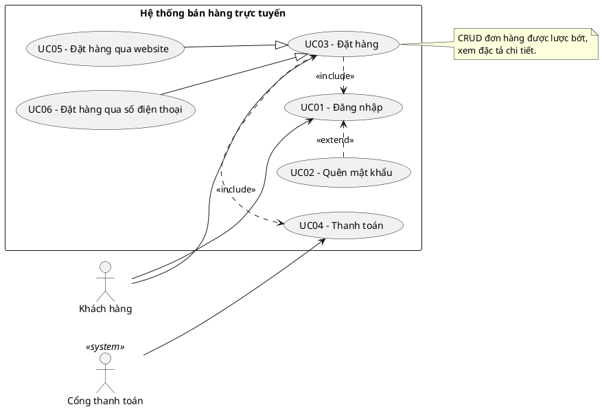
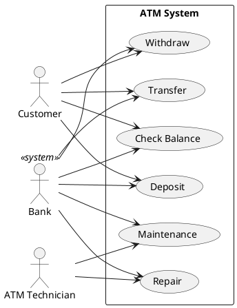

# Hướng dẫn tổng hợp cho AI: Phân tích yêu cầu và vẽ sơ đồ Use Case (Use Case Diagram)

> Tài liệu chỉ dẫn (instruction/skill) cho AI khi người dùng yêu cầu phân tích hệ thống, xác định chức năng và vẽ sơ đồ use case.
> Tổng hợp từ hai nguồn:
> - **[N1]** ITNavi, "Use Case là gì? Quy trình vẽ sơ đồ Use Case hoàn chỉnh": https://itnavi.com.vn/blog/use-case-la-gi
> - **[N2]** iViettech, "2. Bản vẽ Use Case (Use Case Diagram)": https://iviettech.vn/blog/543-ban-ve-use-case-use-case-diagram.html
>
> Ký hiệu: **[N1]**, **[N2]** là nội dung lấy từ nguồn tương ứng. **[Bổ sung]** là phần ngoài hai bài (chuẩn UML, cú pháp code, quy tắc đầu ra cho AI).

---

## 1. Mục tiêu

Khi nhận yêu cầu vẽ use case, AI phải:

1. Hiểu đúng phạm vi hệ thống và người dùng.
2. Xác định đầy đủ **Actor**, **Use Case**, **Relationship** và **System Boundary**.
3. Xuất sơ đồ dạng **code có thể render** (PlantUML mặc định) kèm các bảng giải thích.
4. Nếu người dùng cần, viết thêm **đặc tả Use Case** (mục 8).
5. Tự kiểm tra bằng checklist (mục 10) trước khi trả kết quả.

---

## 2. Use Case Diagram là gì và dùng để làm gì

**Định nghĩa [N1]:** Use Case là kỹ thuật dùng trong kỹ thuật phần mềm và hệ thống để nắm bắt **yêu cầu chức năng**, mô tả sự tương tác đặc trưng giữa người dùng bên ngoài (Actor) và hệ thống, theo **góc nhìn người dùng**, trong một bối cảnh cụ thể, vì một mục đích cụ thể.
Ví dụ: hệ thống "Đặt vé máy bay trực tuyến" có Use Case "Đặt vé".

**Bản vẽ trả lời hai câu hỏi [N2]:** hệ thống sẽ có **những chức năng gì** và **ai dùng chức năng nào**. Nó là bản vẽ đầu tiên và chi phối các bản vẽ còn lại.

Hai dạng tương tác **[N1]**:
- Người dùng tương tác với hệ thống.
- Hệ thống tương tác với hệ thống khác.

**Công dụng của sơ đồ [N2]:**
- Phân tích và hiểu hệ thống.
- Thiết kế hệ thống.
- Làm cơ sở phát triển và kiểm tra Class Diagram, Activity Diagram, Sequence Diagram, Component Diagram.
- Làm cơ sở giao tiếp với khách hàng, nhà đầu tư.
- Hỗ trợ kiểm thử chức năng và kiểm thử chấp nhận.

---

## 3. Bốn thành phần của sơ đồ

| Thành phần | Ý nghĩa | Ký hiệu |
|---|---|---|
| **Actor** | Người dùng hoặc đối tượng bên ngoài tương tác với hệ thống đang xét | Hình người que (hoặc hình hộp có nhãn) |
| **Use Case** | Chức năng mà Actor sử dụng | Hình elip chứa tên |
| **Relationship** | Đường nối (connector) giữa các đối tượng | Đường nối / mũi tên |
| **System Boundary** | Xác định phạm vi hệ thống đang thiết kế; đối tượng nằm ngoài mà có tương tác thì là Actor | Hình chữ nhật bao quanh các Use Case |

Lưu ý của **[N2]**: người ta hay **bỏ quên** các đối tượng tương tác với hệ thống không phải con người (ví dụ "Bank" trong ATM). System Boundary còn giúp chia hệ thống lớn thành hệ thống con để phân tích, thiết kế.

---

## 4. Cách xác định Actor

**Hai câu hỏi cốt lõi [N2]:**
- Ai sử dụng hệ thống này?
- Hệ thống nào tương tác với hệ thống này?

**Câu hỏi mở rộng [N1]:**
- Ai sử dụng chức năng chính (tác nhân chính)?
- Ai là admin: cài đặt, quản lý, bảo trì hệ thống (tác nhân phụ)?
- Ai cần hệ thống hỗ trợ để thực hiện tác vụ hằng ngày?
- Hệ thống có cần tương tác với hệ thống nào khác không?
- Ai nhập dữ liệu vào hệ thống (nếu là hệ thống lưu trữ dữ liệu)?
- Ai hoặc cái gì quan tâm đến giá trị hệ thống mang lại?

**Quy tắc đặt tên [Bổ sung]:** dùng **vai trò** thay vì tên người ("Khách hàng", "Kỹ thuật viên ATM", "Ngân hàng"). Actor là hệ thống ngoài thì ghi tên hệ thống và đánh dấu `<<system>>`.

---

## 5. Cách xác định Use Case

**Câu hỏi cốt lõi [N2]:** các Actor sử dụng chức năng gì trong hệ thống?

**Câu hỏi mở rộng [N1]:**
- Actor cần những chức năng nào? Hành động chính là gì?
- Actor có cần đọc, thêm mới, hủy bỏ, chỉnh sửa hay lưu trữ thông tin nào không?
- Hệ thống có cần thông báo thay đổi bất ngờ trong nội bộ cho Actor không?
- Công việc hằng ngày của Actor có thể đơn giản hóa/hữu hiệu hóa qua chức năng nào?
- Use Case có thể được kích hoạt bởi sự kiện nào khác không?
- Hệ thống cần thông tin đầu vào/đầu ra nào, đi từ đâu đến đâu?
- Khó khăn, thiếu hụt của hệ thống hiện tại nằm ở đâu?

**Quy tắc đặt tên [N1 + Bổ sung]:** dạng động từ + danh từ, ngắn gọn, phản ánh mục đích cuối theo góc nhìn người dùng ("Rút tiền", "Chuyển khoản"). Không đặt quá dài.

---

## 6. Các loại quan hệ

### 6.1 Association (liên kết)
- **[N2]** Mô tả quan hệ giữa Actor và Use Case (và có thể giữa các Use Case với nhau). Ví dụ: Actor "User" sử dụng Use Case "Login".
- **[N1]** chỉ dùng cho Actor – Use Case.
- **[Bổ sung]** Trong UML chuẩn, giữa các Use Case nên dùng include/extend/generalization thay vì association trơn. Mặc định AI chỉ dùng association giữa Actor và Use Case, trừ khi người dùng yêu cầu khác.
- Ký hiệu: đường nối thẳng.

### 6.2 Generalization (tổng quát hóa / thừa kế)
- **[N2]** Thể hiện quan hệ thừa kế giữa các Actor hoặc giữa các Use Case. Ví dụ: Actor "User" thừa kế toàn bộ quyền của Actor "Guest".
- **[N1]** Quan hệ cha–con. Ví dụ Use Case: "Đăng nhập" (cha) có con là "Đăng nhập bằng số điện thoại" và "Đăng nhập bằng Email"; "Đặt hàng" (cha) có con là "Đặt hàng qua số điện thoại" và "Đặt hàng qua website". Ví dụ Actor: "Khách hàng" (cha) có con là "Khách hàng cũ" và "Khách hàng mới".
- Ký hiệu **[Bổ sung]**: mũi tên đầu tam giác rỗng, hướng **từ con tới cha**.

### 6.3 Include (bao gồm)
- **[N1]** Quan hệ bắt buộc: để Use Case A xảy ra thì Use Case B phải hoàn thành. Ví dụ: "Rút tiền" include "Xác thực tài khoản".
- **[N2]** Một Use Case lớn được chia thành các Use Case nhỏ để dễ cài đặt (module hóa) hoặc thể hiện sự **dùng lại**. Ví dụ: "Verify Password" có thể gộp vào "Login", nhưng tách ra để Use Case khác dùng lại hoặc để dễ hiểu, dễ cài đặt.
- Ký hiệu **[Bổ sung]**: mũi tên nét đứt, nhãn `<<include>>`, hướng từ Use Case gốc tới Use Case được bao gồm.

### 6.4 Extend (mở rộng)
- **[N1]** Quan hệ không bắt buộc, có thể xảy ra hoặc không, gắn với một Use Case cụ thể. Ví dụ: "Quên mật khẩu" extend "Đăng nhập hệ thống".
- **[N2]** Dùng khi một Use Case được tạo ra để **bổ sung chức năng** cho Use Case có sẵn và chỉ dùng trong **một điều kiện nhất định**. Ví dụ: "Open Account" là Use Case cơ sở cho khách mở tài khoản; nếu khách hàng là công ty thì có thể thêm người sở hữu, nên "Add Account Holder" extend "Open Account".
- Ký hiệu **[Bổ sung]**: mũi tên nét đứt, nhãn `<<extend>>`, hướng từ Use Case mở rộng **về** Use Case gốc (ngược hướng với include).

### Bảng chọn nhanh

| Tình huống | Quan hệ |
|---|---|
| Actor dùng một chức năng | Association |
| Bước bắt buộc, hoặc phần dùng lại ở nhiều Use Case | Include |
| Bước tùy chọn, chỉ xảy ra khi có điều kiện | Extend |
| Nhiều biến thể cùng một mục đích | Generalization (Use Case) |
| Một Actor có toàn bộ quyền của Actor khác và thêm quyền | Generalization (Actor) |

---

## 7. Quy trình vẽ

### 7.1 Quy trình 3 bước (nhanh) [N2]
1. **Tìm Actor** (ai dùng hệ thống, hệ thống nào tương tác).
2. **Tìm Use Case** (Actor dùng chức năng gì).
3. **Xác định quan hệ** (Actor–Use Case, Actor–Actor, Use Case–Use Case) rồi nối lại.

### 7.2 Quy trình 10 bước (đầy đủ) [N1]

**Giai đoạn mô hình hóa**
1. Thiết lập ngữ cảnh hệ thống.
2. Xác định Actor.
3. Xác định Use Case.
4. Định nghĩa quan hệ giữa Actor và Use Case.
5. Đánh giá các quan hệ đó để tìm cách chi tiết hóa.

**Giai đoạn cấu trúc**
6. Đánh giá Use Case để tìm quan hệ Include.
7. Đánh giá Use Case để tìm quan hệ Extend.
8. Đánh giá Use Case để tìm quan hệ Generalization.

**Giai đoạn review**
9. Kiểm tra (verification): đúng với tài liệu đặc tả.
10. Thẩm định (validation): đúng điều khách hàng cuối thực sự cần.

### 7.3 Cách phối hợp hai quy trình [Bổ sung]
Bước 1–3 của N2 tương ứng bước 1–4 của N1. Mặc định AI dùng quy trình 10 bước; yêu cầu đơn giản thì chạy nhanh theo 3 bước nhưng vẫn phải qua checklist mục 10.

---

## 8. Đặc tả Use Case (bước tiếp theo sau khi vẽ)

Sơ đồ chỉ cho biết **cần chức năng gì và ai dùng**, chưa cho biết chúng vận hành ra sao. Vì vậy cần đặc tả **[N2]**. Có hai cách:

**Cách 1: viết đặc tả theo mẫu [N2]**

| Trường | Nội dung |
|---|---|
| Tên Use Case | Ví dụ: Account Details |
| Mã số Use Case | Ví dụ: UCSEC35 |
| Mô tả tóm tắt | Ví dụ: hiển thị thông tin chi tiết của Account |
| Các bước thực hiện | Liệt kê các bước |
| Điều kiện thoát | Ví dụ: khi người dùng bấm nút Close |
| Yêu cầu đặc biệt | Ghi rõ nếu có |
| Yêu cầu trước khi thực hiện | Ví dụ: phải đăng nhập |
| Điều kiện sau khi thực hiện | Ghi rõ nếu có |

**Cách 2:** dùng Activity Diagram hoặc Sequence Diagram để đặc tả.

**[Bổ sung] Khi nào AI viết đặc tả:** chỉ khi người dùng yêu cầu, hoặc đề nghị ở cuối câu trả lời. Nếu viết, mặc định dùng mẫu Cách 1 và có thể thêm hai trường tùy chọn: "Actor" và "Luồng thay thế/ngoại lệ".

---

## 9. Quy trình thực thi dành cho AI [Bổ sung]

**Bước A. Thu thập thông tin.** Nếu mô tả quá mơ hồ để xác định Actor hoặc chức năng chính, hỏi lại tối đa 1–3 câu ngắn (hệ thống làm gì, ai dùng, có tích hợp hệ thống ngoài không). Nếu đủ thông tin thì làm luôn và nêu rõ các giả định.

**Bước B. Phân tích nháp.** Đi qua mục 4, 5, 6 để liệt kê Actor, Use Case, quan hệ.

**Bước C. Xuất kết quả theo bố cục:**
1. Tóm tắt phạm vi hệ thống và giả định (2–4 dòng).
2. Bảng Actor (tên, mô tả, loại: chính/phụ/hệ thống ngoài).
3. Bảng Use Case (ID, tên, Actor tham gia, mô tả 1 câu).
4. Bảng quan hệ Include/Extend/Generalization kèm lý do chọn.
5. Code sơ đồ (PlantUML) trong khối code.
6. Kết quả checklist: chỉ nêu mục chưa đạt hoặc cần người dùng xác nhận.
7. Đề nghị bước tiếp theo (đặc tả Use Case, hoặc sơ đồ khác).

**Bước D. Tự rà soát** theo mục 10 rồi mới trả lời.

---

## 10. Checklist kiểm tra

**Từ N1:**
- [ ] Tên Use Case ngắn gọn, rõ nghĩa, theo góc nhìn người dùng.
- [ ] Không lạm dụng từ "Manage"; dùng hành động cụ thể ("Duyệt đơn hàng", "Khóa tài khoản").
- [ ] Không thiết kế quá nhiều Use Case; dùng Relationship để liên kết và System Boundary để phân nhóm.
- [ ] Không đi sâu vào CRUD: dùng một dòng ghi chú, hoặc một Use Case "Quản lý X" có chủ đích và có ghi chú.
- [ ] Thẩm mỹ: cùng kích cỡ, có Use Case ID (UC01, UC02...), không chồng chéo đường nối, có thể dùng màu.

**Từ N2:**
- [ ] Đã tìm cả đối tượng **không phải con người** tương tác với hệ thống (hệ thống ngoài, như Bank).
- [ ] Mỗi Use Case đều gắn với ít nhất một Actor (trực tiếp hoặc qua include/extend).
- [ ] Phạm vi hệ thống được thể hiện bằng System Boundary; Actor nằm ngoài boundary.
- [ ] Include dùng cho phần tách ra để dùng lại/module hóa; Extend dùng cho chức năng bổ sung có điều kiện.

**Bổ sung:**
- [ ] Mũi tên include và extend đúng hướng.
- [ ] Use Case là mục tiêu của người dùng, không phải bước của quy trình, không phải màn hình/nút bấm.
- [ ] Gợi ý quy mô: 5–12 Use Case trên một sơ đồ; hệ thống lớn thì tách theo phân hệ, kèm một sơ đồ tổng quan.
- [ ] Mọi giả định đã được nêu; phần thẩm định (bước 10) được giao lại cho người dùng xác nhận.

---

## 11. Mẫu code PlantUML [Bổ sung]

### 11.1 Khung chuẩn

### 11.2 Quy ước cú pháp
- Association: `Actor --> UseCase`
- Include: `A .> B : <<include>>` (A là gốc, B được bao gồm)
- Extend: `B .> A : <<extend>>` (B là mở rộng, A là gốc)
- Generalization: `Con --|> Cha` (dùng cho cả Use Case và Actor)
- Actor là hệ thống ngoài: thêm `<<system>>`
- Ranh giới hệ thống: `rectangle "Tên hệ thống" { ... }`

### 11.3 Phương án dự phòng
Mermaid không có loại biểu đồ use case chính thức. Nếu bắt buộc dùng Mermaid, dùng `flowchart LR` để mô phỏng (Actor dạng stadium/tròn, Use Case dạng elip `([ ])`, nhãn `include`/`extend` trên mũi tên nét đứt) và **nói rõ đây là bản mô phỏng**, không đúng chuẩn UML.

---

## 12. Ví dụ hoàn chỉnh: hệ thống ATM [N2]

**Bước 1: Actor.**
- Ai dùng hệ thống? Customer, ATM Technician.
- Hệ thống nào tương tác? Bank.
- Kết quả: 3 Actor (Customer, ATM Technician, Bank).

**Bước 2: Use Case.**
- Customer dùng: Check Balance, Deposit, Withdraw, Transfer.
- ATM Technician dùng: Maintenance, Repair.
- Bank tương tác với tất cả các chức năng trên.
- Kết quả: 6 Use Case.

**Bước 3: Quan hệ.** Nối từng Actor với Use Case tương ứng.

**Ví dụ nhỏ về quan hệ [N1 + N2]:**
- "Rút tiền" include "Xác thực tài khoản" (bắt buộc).
- "Quên mã PIN" extend "Xác thực tài khoản" (tùy chọn).
- Actor "User" thừa kế mọi quyền của Actor "Guest" (generalization giữa Actor).

---

## 13. Điểm khác biệt giữa hai nguồn và cách AI xử lý

| Chủ đề | N1 (ITNavi) | N2 (iViettech) | Cách xử lý |
|---|---|---|---|
| Association | Chỉ nêu Actor – Use Case | Cả Actor–Use Case và Use Case–Use Case | Mặc định chỉ Actor – Use Case; Use Case – Use Case dùng include/extend/generalization |
| Include | Bắt buộc ("A xảy ra thì B phải xong") | Tách module/dùng lại | Kết hợp: bắt buộc và/hoặc dùng chung |
| Extend | Không bắt buộc, gắn với một Use Case | Bổ sung chức năng theo điều kiện | Kết hợp: tùy chọn, có điều kiện kích hoạt |
| Generalization Actor | Khách hàng cũ/mới | User thừa kế quyền Guest | Dùng khi Actor con có toàn bộ quyền của Actor cha |
| System Boundary | Khuyên dùng để phân nhóm | Là thành phần chính thức | Luôn vẽ boundary |
| Quy trình | 10 bước, 3 giai đoạn | 3 bước | Xem mục 7.3 |
| Đặc tả Use Case | Không có | Có mẫu và 2 cách | Xem mục 8 |
| Lưu ý thẩm mỹ, đặt tên | Có (5 lưu ý) | Không có | Dùng đầy đủ từ N1 |

---

## 14. Những điều AI không được làm

- Không bịa chức năng ngoài phạm vi người dùng mô tả mà không ghi rõ là đề xuất/giả định.
- Không quên Actor là hệ thống ngoài (lỗi hay gặp theo N2).
- Không dùng tên "Manage ..." chung chung.
- Không vẽ Use Case ở mức màn hình/nút bấm hoặc hàm kỹ thuật.
- Không nhầm hướng include/extend.
- Không trả về chỉ mỗi code mà thiếu bảng giải thích.
- Không khẳng định sơ đồ "đã đúng yêu cầu khách hàng" khi chưa có người dùng xác nhận.

---

## 15. Nguồn

- [N1] ITNavi, "Use Case là gì? Quy trình vẽ sơ đồ Use Case hoàn chỉnh": https://itnavi.com.vn/blog/use-case-la-gi
- [N2] iViettech, "2. Bản vẽ Use Case (Use Case Diagram)": https://iviettech.vn/blog/543-ban-ve-use-case-use-case-diagram.html
